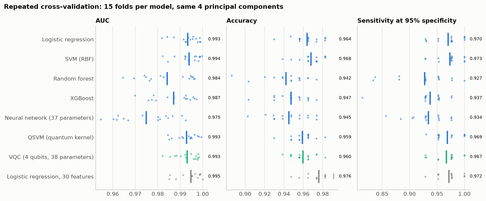
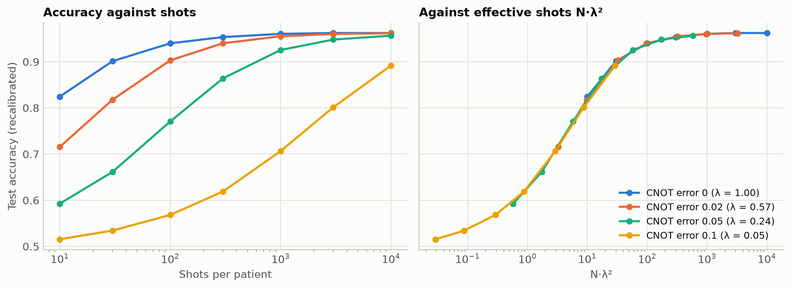

# QML

Hybrid Quantum-Classical Machine Learning Approach for Breast Cancer Classification Using Variational Quantum Classifier

A reproducible study comparing a 4-qubit Variational Quantum Classifier (VQC) and a quantum-kernel SVM with classical models on the Breast Cancer Wisconsin (Diagnostic) dataset, plus an interactive demo app.

**Full write-up: [paper/paper.md](paper/paper.md)**

## Results

Held-out test set, 114 patients. Positive class = malignant, so recall is clinical sensitivity.

| Model | Input | Accuracy | Precision | Recall | F1 | ROC AUC |
|---|---|---|---|---|---|---|
| Logistic Regression | 30 features | 0.965 | 0.975 | 0.929 | 0.951 | 0.996 |
| SVM (RBF) | 30 features | 0.974 | 1.000 | 0.929 | 0.963 | 0.995 |
| Random Forest | 30 features | 0.974 | 1.000 | 0.929 | 0.963 | 0.994 |
| XGBoost | 30 features | 0.965 | 1.000 | 0.905 | 0.950 | 0.993 |
| Logistic Regression | 4 PCA components | 0.974 | 1.000 | 0.929 | 0.963 | 0.998 |
| SVM (RBF) | 4 PCA components | 0.947 | 0.974 | 0.881 | 0.925 | 0.997 |
| Random Forest | 4 PCA components | 0.956 | 0.974 | 0.905 | 0.938 | 0.995 |
| XGBoost | 4 PCA components | 0.939 | 0.973 | 0.857 | 0.911 | 0.994 |
| QSVM (quantum kernel) | 4 qubits | 0.947 | 0.974 | 0.881 | 0.925 | 0.997 |
| **VQC** (mean ± s.d., 5 seeds) | 4 qubits | 0.956 ± 0.018 | 0.976 ± 0.025 | 0.905 ± 0.067 | 0.937 ± 0.030 | 0.997 ± 0.001 |


The quantum models are competitive with classical models but not better, and the differences are within the uncertainty of a 114-sample test set. No quantum advantage is claimed. See the paper for the analysis, including why the VQC's sensitivity depends on its random initialisation and why a one-layer circuit fails.

## Beyond accuracy: reliable, robust, explainable

Three extensions ask what it would take to trust the quantum model in a clinic.

**1. Reliable.** A single VQC run misses between 1 and 9 of the 42 test cancers depending on its random starting point. An ensemble of five circuits, with the decision threshold calibrated for 98% sensitivity on out-of-fold training predictions, misses 1, with 3 false alarms. Logistic regression calibrated the same way gives exactly the same result.


**2. Robust.** With simulated gate errors the model as trained collapses (74% accuracy at 10% CNOT error), yet its ranking of patients is intact (AUC 0.996). Refitting two classical read-out numbers restores 95% accuracy without retraining the circuit. What noise really costs is measurement shots: about 300 per patient on a perfect device, about 1000 at 2% CNOT error.


**3. Explainable.** Integrated gradients, computed with the parameter-shift rule, attribute every prediction to the 30 original measurements. The quantum model relies on the same cell-nucleus properties as the classical one (texture first, then size), and can show why a borderline case is borderline.


Noise results use a simplified depolarising model in simulation, not a real device.

**Checked without the test set.** Both procedures were repeated on five validation splits of the training data. The noise recalibration is confirmed (82% to 95% accuracy at 10% CNOT error). The calibrated threshold again raises sensitivity (92% to 98%, 13 missed cancers out of 170 down to 4), but at a specificity of 91%, lower than the 96% seen on the test set, so expect about 9% false alarms. Calibrating on too few patients (34 cancers) makes the threshold unreliable. See Section 6.4 of the paper.

## Stronger evidence

Four further analyses (paper, Section 7) tighten the comparison and test the claims above.

**Fair comparison.** 5-fold cross-validation repeated 3 times over all 569 patients. Every model gets the same 4 principal components; the classical models are tuned by inner cross-validation, and a classical neural network with the same number of parameters as the VQC (37 vs 38) is added. Differences are tested with corrected resampled t-tests and McNemar tests, Holm-adjusted.

| Model, 4 principal components | AUC | Accuracy | Sensitivity at 95% specificity |
|---|---|---|---|
| Logistic regression (tuned) | 0.993 | 0.964 | 0.970 |
| SVM, RBF (tuned) | 0.994 | 0.968 | 0.973 |
| Random forest (tuned) | 0.984 | 0.942 | 0.928 |
| XGBoost (tuned) | 0.987 | 0.947 | 0.937 |
| Neural network, 37 parameters | 0.975 | 0.945 | 0.934 |
| QSVM (tuned) | 0.993 | 0.959 | 0.969 |
| **VQC, 38 parameters** | **0.993** | **0.960** | **0.967** |

The VQC is indistinguishable from the best classical models and better than the tree ensembles and the equal-size network, which a five-parameter logistic regression also is, so that is not a quantum effect.



**AUC and sensitivity.** All AUCs are at the ceiling (test-set intervals overlap; VQC minus logistic regression +0.002, 95% CI −0.004 to +0.009). Sensitivity on 42 test cancers has wide intervals (41/42: 0.877 to 0.996). Compared at a fixed 95% specificity, the models find the same number of cancers.

**Why recalibration undoes noise.** For depolarising, amplitude-damping and read-out errors, the noisy circuit output is an affine copy of the clean one (R² ≥ 0.99). That keeps the ranking, explains why refitting two numbers restores accuracy, and predicts that the shots needed grow as 1/λ²; accuracy curves at four noise levels collapse onto one when plotted against N·λ². Coherent over-rotation breaks the affine relation and the recovery, as the hypothesis predicted.



**How far the explanations can be trusted.** Integrated gradients agree with exact Shapley values, are faithful in a deletion test (they remove the prediction faster than a random order or an order borrowed from logistic regression) and are stable across the five circuits. They only partly pass a weight-randomisation sanity check: through the PCA map, each patient's 30 feature attributions are fixed by four numbers from the circuit, so part of what they show is the PCA.

**Novelty.** A closely related 2026 study (Zorlu and Colak, *Diagnostics* 16, 1996) already benchmarks a VQC on this dataset with noise tests, calibration and explainability. What this project adds is the separation of discrimination from calibration under noise, its tested mechanism, and explanation checks on the quantum model itself. See Section 1.1 of the paper.

## The quantum model


30 features → standardise → PCA to 4 components → rescale to angles in [0, π] → RY angle encoding on 4 qubits → 3 layers of RX-RY-RZ rotations and a CNOT ring → measure ⟨Z₀⟩ → classical sigmoid read-out. 38 trainable parameters, trained with Adam on the binary cross-entropy, simulated with PennyLane.

## Run it

```bash
python -m venv .venv
.venv\Scripts\activate            # Windows;  source .venv/bin/activate on Linux/macOS
pip install -r requirements.txt

python run_experiment.py          # base study, about 8 minutes on a laptop CPU
python run_experiment.py --quick  # skips VQC cross-validation and the ablation, about 2 minutes
python run_extensions.py          # ensemble, noise and explainability, about 20 minutes
python run_validation_check.py    # calibration and noise checks on validation splits, about 8 minutes
python run_validation_check.py --oof   # the same with the main study's threshold procedure, about 40 minutes
python run_fair_comparison.py     # repeated CV, tuned and parameter-matched baselines, tests, about 15 minutes
python run_noise_mechanism.py     # affine-noise mechanism, four error models, shot collapse, about 15 minutes
python run_explanation_checks.py  # Shapley agreement, deletion, sanity and stability checks, about 3 minutes
```

This regenerates everything in `results/` and the trained models in `models/`.

### Demo app

```bash
streamlit run app.py
```

Four tabs:

- **Diagnosis**: pick a held-out patient, adjust the most predictive measurements, and compare the quantum ensemble, the QSVM and logistic regression. A screening-mode switch applies the calibrated threshold.
- **Why this prediction**: the measurements that pushed this patient's score towards malignant or benign.
- **Quantum circuit and noise**: the rotation angles sent to each qubit, and a simulator for gate errors and limited shots.
- **Study results**: the tables and figures of the study.

Research demonstration only, not for clinical use.

On Windows, if activating the environment is blocked, run `.venv\Scripts\python.exe -m streamlit run app.py`.

## Layout

```
qmlbc/
  config.py      every setting that shapes a result (seeds, qubits, layers, epochs)
  data.py        loading, split, preprocessing steps
  classical.py   Logistic Regression, SVM, Random Forest, XGBoost
  vqc.py         variational quantum classifier
  qkernel.py     quantum-kernel SVM
  ensemble.py    VQC ensemble and sensitivity-calibrated threshold
  noise.py       gate-error and shot-noise simulation, read-out recalibration
  explain.py     integrated-gradient attributions
  metrics.py     accuracy, precision, recall, F1, ROC AUC
  stats.py       Wilson and bootstrap intervals, corrected t-test, McNemar, Holm, calibration error
  plots.py       all figures
run_experiment.py   base study: EDA, baselines, QSVM, VQC, ablation
run_extensions.py   ensemble and calibration, noise study, explainability
run_validation_check.py   the same checks on validation splits, test set untouched
run_fair_comparison.py    repeated cross-validation comparison with statistics
run_noise_mechanism.py    why read-out recalibration works, and when it fails
run_explanation_checks.py validity checks of the explanations
app.py              Streamlit demo
paper/paper.md      the research paper
results/            CSV tables, summary.json, extensions.json, figures/
models/             fitted pipelines used by the app
```

## Notes on method

- scikit-learn labels malignant as 0; this project flips it to 1 so the disease is the positive class.
- Scaling, PCA and angle rescaling are pipeline steps, fitted on training data only (also inside cross-validation), so nothing leaks from the test set.
- Classical models are run on all 30 features and on the same 4 PCA components as the quantum models, so the comparison is like for like.
- The VQC is reported as the mean over 5 random initialisations.
