# Hybrid Quantum-Classical Machine Learning Approach for Breast Cancer Classification Using a Variational Quantum Classifier

**Abdullah Mahmood**

*All numbers, tables and figures in this document are produced by `run_experiment.py` in this repository and can be regenerated with one command.*

---

## Abstract

We study whether a small hybrid quantum-classical model can match classical machine learning on a standard medical classification task. Using the Breast Cancer Wisconsin (Diagnostic) dataset (569 samples, 30 features), we reduce the data to four principal components and classify them with two quantum models simulated on four qubits: a Variational Quantum Classifier (VQC) with RY angle encoding and three RX-RY-RZ + CNOT layers (38 trainable parameters), and a support vector machine using a quantum fidelity kernel (QSVM). They are compared with logistic regression, an RBF support vector machine, a random forest and XGBoost, each trained both on all 30 features and on the same four principal components. On a held-out test set of 114 patients the VQC reaches an accuracy of 0.956 ± 0.018 and a ROC AUC of 0.997 ± 0.001 (mean ± s.d. over five random initialisations), and the QSVM reaches 0.947 (AUC 0.997). The best classical models reach 0.974. The quantum models are therefore competitive with, but not better than, classical baselines, and the differences are within the statistical uncertainty of the test set. We find that the VQC's ranking of patients is stable across initialisations while its decision threshold is not (sensitivity ranges from 0.79 to 0.98), and we show analytically and empirically why a one-layer version of the circuit fails. Three extensions follow from these findings. An ensemble of five circuits with a threshold calibrated for 98% sensitivity detects 41 of 42 test cancers, identical to a classical model calibrated the same way, although a check on validation splits shows the calibrated threshold to be unstable when little calibration data is available. Under simulated gate noise the model's ranking survives (AUC 0.996 at 10% CNOT error) and accuracy is recovered by refitting two classical read-out parameters, at the cost of more measurement shots. Integrated-gradient explanations show the quantum model relying on the same cell-nucleus properties as the classical one. No quantum advantage is claimed or observed; the contribution is a leakage-free, reproducible benchmark and an analysis of where such models stand.

---

## 1. Introduction

Breast cancer is the most frequently diagnosed cancer in women, and distinguishing malignant from benign masses early is central to treatment outcome. Fine-needle aspiration cytology yields digitised images of cell nuclei from which shape and texture descriptors can be computed, and classical machine learning on these descriptors has long achieved accuracies above 95% [1].

Quantum machine learning (QML) proposes to use parameterised quantum circuits as trainable models [2, 3]. Data are mapped into the exponentially large Hilbert space of a qubit register, processed by a circuit whose gate angles are trained by a classical optimiser, and read out by measurement. Such a model is *hybrid*: the quantum processor evaluates a function, the classical computer optimises it. Two families dominate: variational classifiers, which train the circuit directly [3, 4], and quantum kernel methods, which use the circuit only to compute similarities between data points [5, 6].

Whether these models offer any practical benefit on real tabular data is an open question. Careful benchmarking has shown that reported gains often vanish under like-for-like comparison [7], and theory indicates that an advantage requires data with structure that the quantum feature map can exploit and classical models cannot [8].

**Research question.** Can a hybrid quantum-classical model achieve competitive classification performance for breast cancer diagnosis when compared fairly with classical models?

**Contributions.**

1. A complete, reproducible pipeline from raw data to results, in which every preprocessing step is fitted on training data only.
2. A like-for-like comparison: classical models are evaluated both on all 30 features and on exactly the four principal components the quantum models receive, separating the cost of dimensionality reduction from the effect of the model.
3. Reporting of the VQC over several random initialisations, not a single run.
4. An ablation over circuit depth and encoding strategy, including an analytical explanation of the failure of the one-layer circuit.
5. Three extensions aimed at clinical readiness: an ensemble with a sensitivity-calibrated threshold, a study of gate and shot noise with a classical read-out recalibration, and per-patient explanations by integrated gradients evaluated with the parameter-shift rule.

---

## 2. Dataset

We use the Breast Cancer Wisconsin (Diagnostic) dataset [1] as distributed with scikit-learn [9].

| Property | Value |
|---|---|
| Samples | 569 |
| Malignant | 212 (37.3%) |
| Benign | 357 (62.7%) |
| Features | 30, real-valued, no missing values |

Ten quantities are measured for each cell nucleus in the image (radius, texture, perimeter, area, smoothness, compactness, concavity, concave points, symmetry, fractal dimension). For each quantity the mean, the standard error and the "worst" value (mean of the three largest) are recorded, giving 30 features.

**Label convention.** scikit-learn encodes malignant as 0 and benign as 1. We flip this so that

$$
y = \begin{cases} 1, & \text{malignant} \\ 0, & \text{benign} \end{cases}
$$

The positive class is then the disease, so that recall equals clinical *sensitivity* (the fraction of cancers detected) and precision equals the positive predictive value.

### Exploratory analysis

The classes are moderately imbalanced (Figure 1), which is why precision, recall and F1 are reported alongside accuracy.

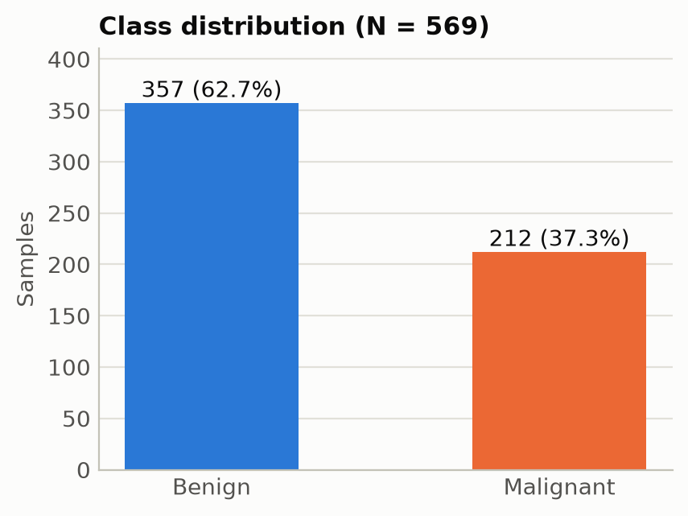

*Figure 1. Class distribution.*

The features most correlated with malignancy are size and concavity descriptors (Figure 2): worst concave points, worst perimeter, mean concave points and worst radius all have a point-biserial correlation above 0.77 with the label.

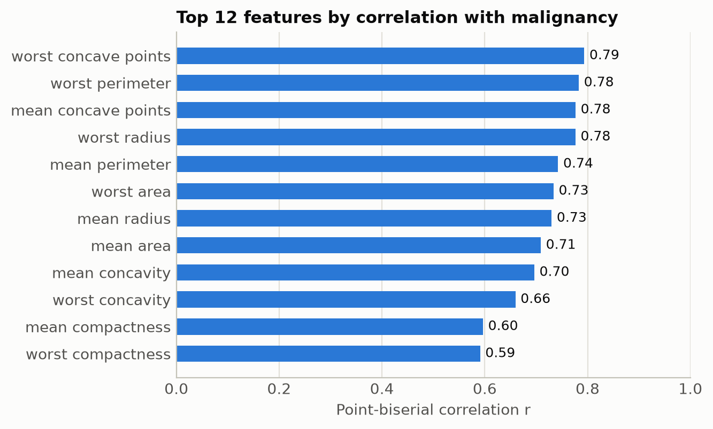

*Figure 2. The twelve features most correlated with malignancy.*

The features are strongly redundant (Figure 3): radius, perimeter and area are correlated at r ≥ 0.99, as geometry dictates. This redundancy is what makes aggressive dimensionality reduction viable.

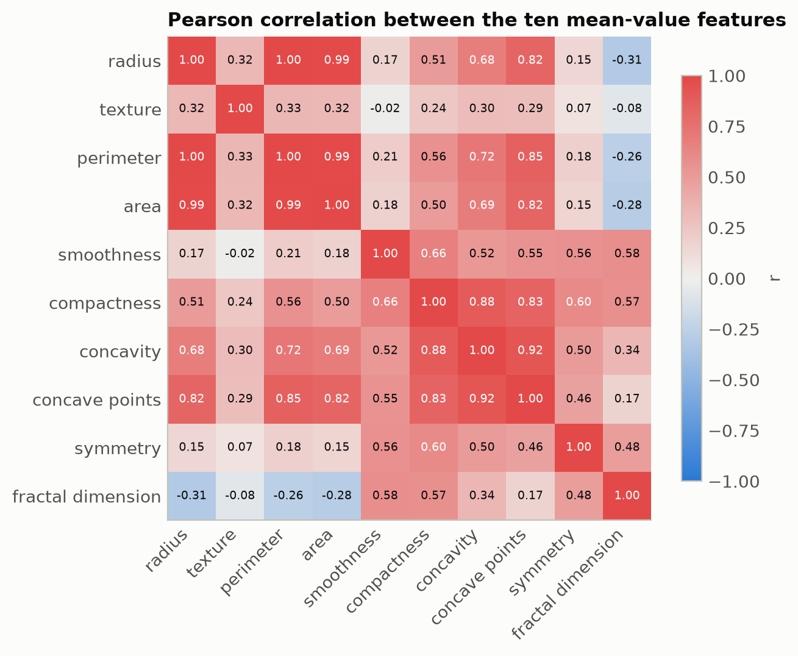

*Figure 3. Pearson correlation between the ten mean-value features.*

---

## 3. Methodology

### 3.1 Pipeline

```
30 features ──► stratified 80/20 split ──► StandardScaler ──► PCA (4) ──► rescale to [0, π] ──► quantum circuit ──► prediction
                                           └──────── fitted on training data only ────────┘
```

### 3.2 Train/test split

The data are split once into 455 training samples (170 malignant) and 114 test samples (42 malignant), stratified by class, with a fixed random seed. The test set is used only for the final evaluation. Model selection (the QSVM hyperparameters and the ablation study) uses cross-validation or a validation split *inside* the training set.

### 3.3 Preprocessing and avoiding leakage

Each feature is standardised, $x_j \leftarrow (x_j - \mu_j)/\sigma_j$, because the features span several orders of magnitude (area ~ 10³, smoothness ~ 10⁻¹) and both PCA and gradient-based training are scale sensitive.

All transforms (standardisation, PCA, angle rescaling) are implemented as steps of a scikit-learn `Pipeline` together with the classifier. Their parameters are therefore estimated from the training fold only, also within cross-validation. Fitting them on the full dataset would leak test-set statistics into training and bias the results optimistically.

### 3.4 Dimensionality reduction

A simulated or real quantum circuit with angle encoding needs one qubit per feature, and current devices offer few reliable qubits. We therefore project the standardised data onto the first $n = 4$ principal components,

$$
z = W^\top \tilde{x}, \qquad W \in \mathbb{R}^{30 \times 4},
$$

where the columns of $W$ are the leading eigenvectors of the training covariance matrix. The four components explain 44.6%, 18.5%, 9.6% and 6.6% of the variance, 79.3% in total (Figure 4). The two classes are already largely separated along the first component (Figure 5).

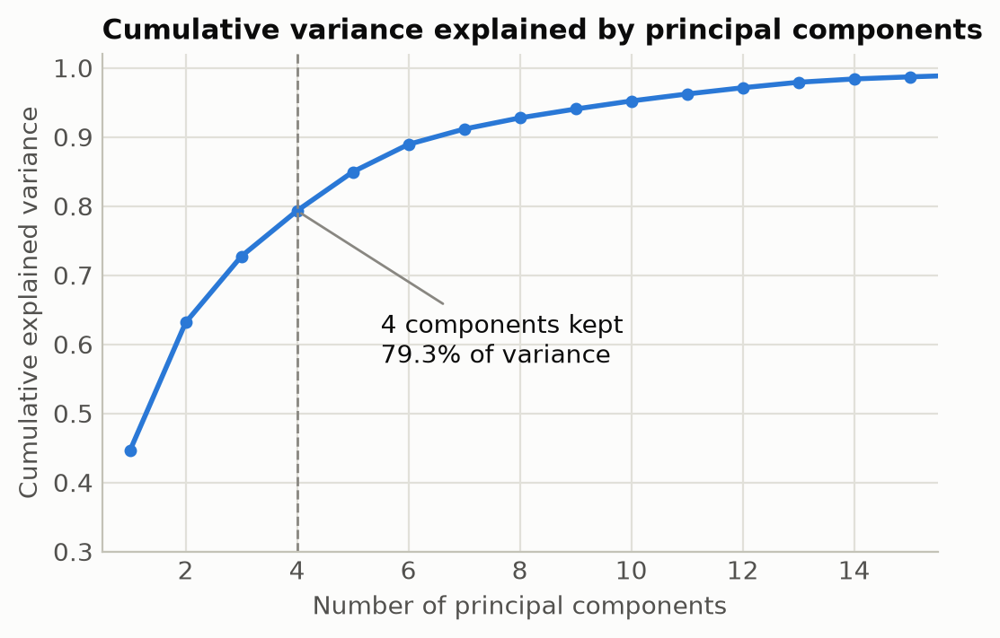

*Figure 4. Cumulative explained variance.*

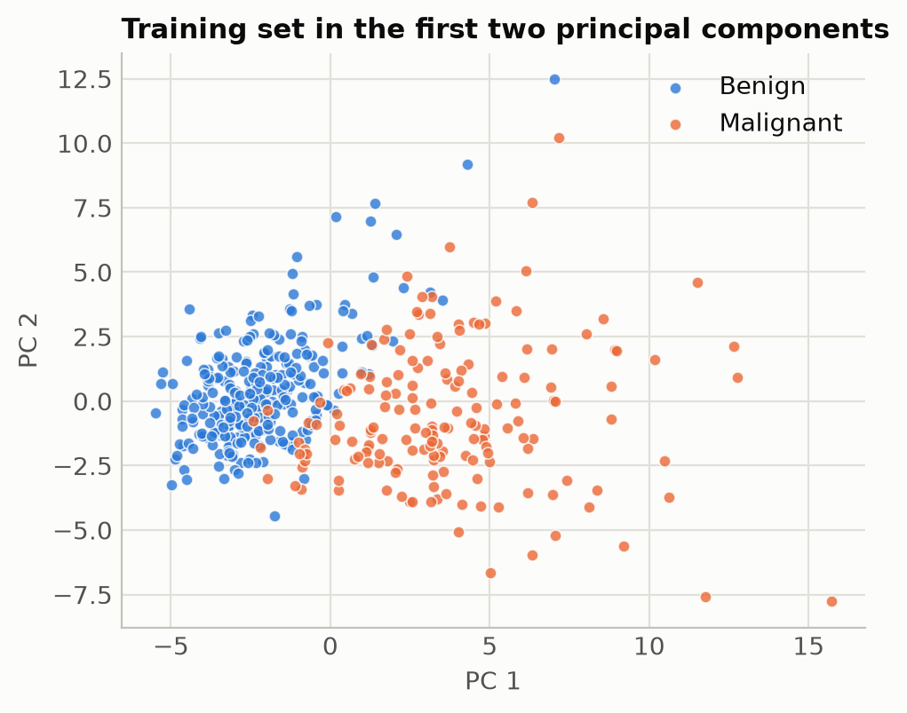

*Figure 5. Training set in the first two principal components.*

PCA is unsupervised: it keeps directions of high variance, which need not be the most discriminative ones. This is a limitation discussed in Section 7.

### 3.5 Classical baselines

Four standard models are trained with fixed, conventional hyperparameters: logistic regression, a support vector machine with RBF kernel, a random forest (300 trees) and XGBoost (300 trees, depth 3, learning rate 0.1). Each is trained in two settings:

- **30 features**: the strongest classical reference.
- **4 PCA components**: the same input the quantum models receive. Differences between these models and the quantum models are attributable to the model and not to information lost in PCA.

### 3.6 Evaluation

With TP, TN, FP, FN the entries of the confusion matrix (positive = malignant):

$$
\text{Accuracy}=\frac{TP+TN}{TP+TN+FP+FN}, \qquad
\text{Precision}=\frac{TP}{TP+FP}, \qquad
\text{Recall}=\frac{TP}{TP+FN},
$$

$$
F_1 = 2\,\frac{\text{Precision}\times\text{Recall}}{\text{Precision}+\text{Recall}} .
$$

A false negative (a missed cancer) is clinically far more costly than a false positive, so recall is the metric of primary interest. We also report the area under the ROC curve (AUC), which measures how well the model *ranks* patients independently of the decision threshold, and the 5-fold stratified cross-validation accuracy on the training set.

---

## 4. Model Architecture

### 4.1 Feature encoding

Each principal component is rescaled linearly to an angle $x_i \in [0, \pi]$ (min-max scaling fitted on the training set, with out-of-range test values clipped). The classical vector is then written into a quantum state by **angle encoding**: one RY rotation per qubit acting on $|0\rangle^{\otimes n}$,

$$
|\psi(x)\rangle = \bigotimes_{i=1}^{n} R_y(x_i)\,|0\rangle
= \bigotimes_{i=1}^{n}\left(\cos\frac{x_i}{2}\,|0\rangle + \sin\frac{x_i}{2}\,|1\rangle\right),
\qquad
R_y(\theta) = e^{-i\theta Y/2} =
\begin{pmatrix}\cos\frac{\theta}{2} & -\sin\frac{\theta}{2}\\ \sin\frac{\theta}{2} & \cos\frac{\theta}{2}\end{pmatrix}.
$$

The range $[0,\pi]$ is chosen because the map $x_i \mapsto R_y(x_i)|0\rangle$ is one-to-one on it: $x_i = 0$ gives $|0\rangle$, $x_i = \pi$ gives $|1\rangle$, and no two feature values produce the same state. The encoded state is a product state; it uses $n$ qubits for $n$ features and a circuit of depth one.

### 4.2 Variational ansatz

The encoded state is processed by $L$ identical layers. Layer $\ell$ applies three single-qubit rotations to every qubit, followed by a ring of CNOT gates:

$$
U_\ell(\theta_\ell) = \underbrace{\left(\prod_{i=1}^{n} \mathrm{CNOT}_{i,\,i+1 \bmod n}\right)}_{\text{entanglement}}
\;\underbrace{\bigotimes_{i=1}^{n} R_z(\theta_{\ell,i,3})\,R_y(\theta_{\ell,i,2})\,R_x(\theta_{\ell,i,1})}_{\text{trainable rotations}},
$$

with $R_P(\theta) = e^{-i\theta P/2}$ for $P \in \{X, Y, Z\}$. The three rotations together can realise any single-qubit unitary; the CNOT gates create entanglement, without which the model would factorise into $n$ independent single-qubit models. The full circuit is

$$
|\phi(x;\theta)\rangle = U_L(\theta_L)\cdots U_1(\theta_1)\,|\psi(x)\rangle .
$$

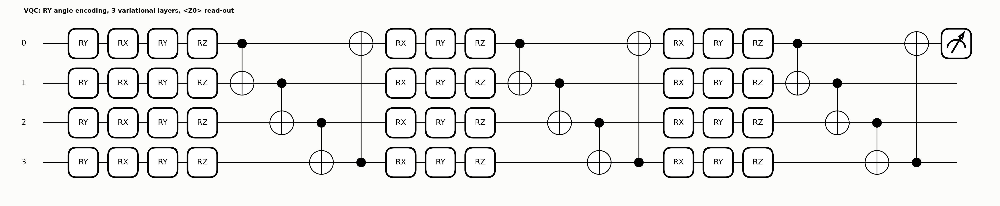

*Figure 6. The VQC for n = 4 qubits and L = 3 layers.*

| Quantity | Value |
|---|---|
| Qubits | 4 |
| Encoding | RY angle encoding, one feature per qubit |
| Variational layers | 3 |
| Gates per layer | 4 RX, 4 RY, 4 RZ, 4 CNOT |
| Total gates | 4 (encoding) + 36 rotations + 12 CNOT |
| Circuit parameters | 3 × 4 × 3 = 36 |
| Classical read-out parameters | 2 |
| Simulator | PennyLane `default.qubit`, exact state vector (no shot noise) |

### 4.3 Measurement and hybrid read-out

The model output is the expectation value of Pauli-Z on the first qubit,

$$
f(x;\theta) = \langle \phi(x;\theta)|\, Z_0 \,|\phi(x;\theta)\rangle \in [-1, 1].
$$

On hardware this is estimated from repeated measurements as $p(0) - p(1)$ on qubit 0. A classical affine map and sigmoid convert it into a probability:

$$
P(y = 1 \mid x) = \sigma\big(a\, f(x;\theta) + b\big), \qquad \sigma(t) = \frac{1}{1+e^{-t}} .
$$

The scale $a$ and bias $b$ are trained with the circuit. Without $a$, the probability would be confined to $[\sigma(-1), \sigma(1)] = [0.27, 0.73]$ and the model could never be confident. A patient is classified as malignant when $P(y=1\mid x) > 0.5$.

### 4.4 Training

The parameters $(\theta, a, b)$ minimise the binary cross-entropy on the training set,

$$
\mathcal{L}(\theta, a, b) = -\frac{1}{N}\sum_{k=1}^{N}\Big[y_k \log p_k + (1-y_k)\log(1-p_k)\Big], \qquad p_k = P(y=1\mid x_k),
$$

using the Adam optimiser (learning rate 0.05, mini-batches of 32, 40 epochs). Circuit weights are initialised uniformly in $[0, 2\pi)$, with $a = 1$, $b = 0$.

**Gradients.** For a gate $e^{-i\theta P/2}$ with Pauli generator $P$, the derivative of an expectation value is given exactly by the parameter-shift rule [3, 10],

$$
\frac{\partial f}{\partial \theta_j} = \frac{1}{2}\left[f\!\left(\theta_j + \tfrac{\pi}{2}\right) - f\!\left(\theta_j - \tfrac{\pi}{2}\right)\right],
$$

which requires only two further circuit evaluations per parameter and is therefore usable on real hardware. In simulation we obtain the same gradients more cheaply by backpropagation through the state vector.

### 4.5 What function class is this?

A circuit in which each feature enters through a single Pauli rotation is a truncated Fourier series in that feature [11]: $f$ contains only the frequencies $\{-1, 0, 1\}$ in each $x_i$, i.e. it is a multilinear polynomial in $\cos x_i$ and $\sin x_i$. The trainable layers determine the Fourier coefficients but cannot add frequencies. Repeating the encoding before each of the $L$ layers ("data re-uploading" [12]) raises the accessible frequencies to $\{-L,\dots,L\}$ and so enlarges the function class. Both variants are compared in Section 5.4.

### 4.6 Quantum kernel SVM

The second quantum model keeps the circuit fixed and trains nothing inside it. Data are embedded with the IQP-type feature map of Havlíček et al. [5],

$$
|\Phi(x)\rangle = \Big[\,U_Z(x)\,H^{\otimes n}\Big]^{2}|0\rangle^{\otimes n}, \qquad
U_Z(x) = \exp\!\Big(-\tfrac{i}{2}\sum_i x_i Z_i - \tfrac{i}{2}\sum_{i<j} x_i x_j Z_i Z_j\Big),
$$

and similarity between two patients is the state fidelity

$$
k(x, x') = \big|\langle \Phi(x) | \Phi(x') \rangle\big|^2 .
$$

A classical SVM is trained on the kernel matrix $K_{kl} = k(x_k, x_l)$. On hardware, $k(x,x')$ is estimated as the probability of measuring all zeros after applying $\Phi(x')^\dagger\Phi(x)$; in noiseless simulation the same quantity is computed exactly from the state vectors. Inputs are multiplied by a bandwidth $c$ before embedding, which controls how quickly the kernel decays with distance and counteracts the tendency of fidelity kernels to concentrate towards the identity matrix [13, 14]. The bandwidth $c \in \{0.05, 0.1, 0.25, 0.5, 1\}$ and the SVM regularisation $C \in \{0.1, 1, 10\}$ are selected by 5-fold cross-validation on the training set; the selected values are $c = 0.25$, $C = 10$.

---

## 5. Results

### 5.1 Model comparison

**Table 1.** Performance on the held-out test set (n = 114; 42 malignant, 72 benign). Positive class: malignant. CV = 5-fold cross-validation accuracy on the training set (mean ± s.d.). The VQC row is the mean ± s.d. over five random initialisations; its CV entry is for seed 0.

| Model | Input | Accuracy | Precision | Recall | F1 | ROC AUC | CV accuracy |
|---|---|---|---|---|---|---|---|
| Logistic Regression | 30 features | 0.965 | 0.975 | 0.929 | 0.951 | 0.996 | 0.974 ± 0.015 |
| SVM (RBF) | 30 features | **0.974** | 1.000 | 0.929 | 0.963 | 0.995 | 0.971 ± 0.005 |
| Random Forest | 30 features | **0.974** | 1.000 | 0.929 | 0.963 | 0.994 | 0.960 ± 0.016 |
| XGBoost | 30 features | 0.965 | 1.000 | 0.905 | 0.950 | 0.993 | 0.971 ± 0.011 |
| Logistic Regression | 4 PCs | **0.974** | 1.000 | 0.929 | 0.963 | 0.998 | 0.963 ± 0.005 |
| SVM (RBF) | 4 PCs | 0.947 | 0.974 | 0.881 | 0.925 | 0.997 | 0.954 ± 0.013 |
| Random Forest | 4 PCs | 0.956 | 0.974 | 0.905 | 0.938 | 0.995 | 0.938 ± 0.029 |
| XGBoost | 4 PCs | 0.939 | 0.973 | 0.857 | 0.911 | 0.994 | 0.945 ± 0.012 |
| QSVM (quantum kernel) | 4 PCs, 4 qubits | 0.947 | 0.974 | 0.881 | 0.925 | 0.997 | 0.960 ± 0.009 |
| **VQC** (5 seeds) | 4 PCs, 4 qubits | 0.956 ± 0.018 | 0.976 ± 0.025 | 0.905 ± 0.067 | 0.937 ± 0.030 | 0.997 ± 0.001 | 0.960 ± 0.009 |

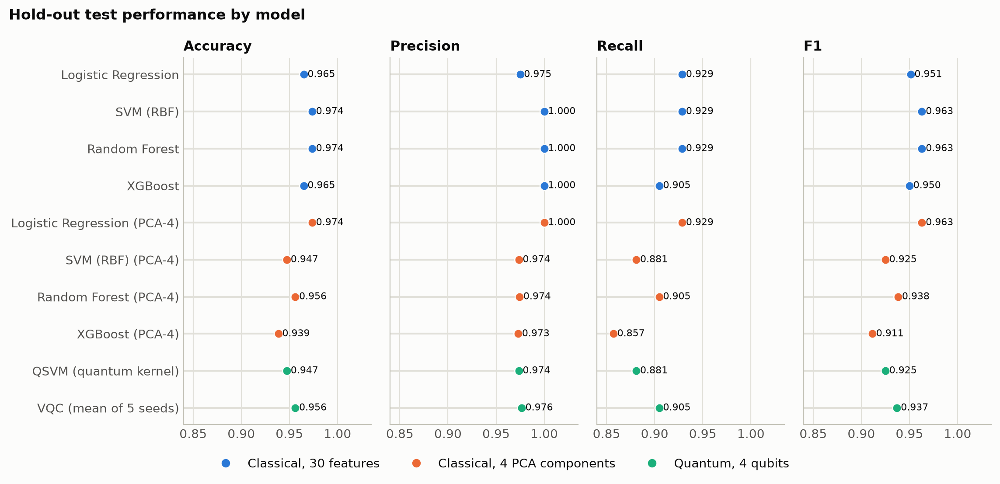

*Figure 7. Test-set metrics for all models, grouped by family.*

Three observations:

1. **All models fall in a narrow band**, 0.939 to 0.974 accuracy. One test sample corresponds to 0.88 percentage points, so the gap between the best classical model and the mean VQC is two patients.
2. **The quantum models are on par with classical models given the same four inputs.** The VQC (0.956) and QSVM (0.947) lie inside the range of the four classical PCA models (0.939 to 0.974).
3. **PCA costs little here.** Logistic regression on four components (0.974) matches the best model on 30 features, so 79% of the variance carries essentially all the diagnostic signal.

### 5.2 Variability of the VQC

**Table 2.** VQC test results for each random initialisation.

| Seed | Accuracy | Precision | Recall | F1 | ROC AUC | False negatives | False positives |
|---|---|---|---|---|---|---|---|
| 0 | 0.965 | 0.932 | 0.976 | 0.953 | 0.997 | 1 | 3 |
| 1 | 0.956 | 1.000 | 0.881 | 0.937 | 0.998 | 5 | 0 |
| 2 | 0.965 | 0.975 | 0.929 | 0.951 | 0.994 | 3 | 1 |
| 3 | 0.974 | 0.976 | 0.952 | 0.964 | 0.998 | 2 | 1 |
| 4 | 0.921 | 1.000 | 0.786 | 0.880 | 0.996 | 9 | 0 |
| **Mean ± s.d.** | 0.956 ± 0.018 | 0.976 ± 0.025 | 0.905 ± 0.067 | 0.937 ± 0.030 | 0.997 ± 0.001 | | |

The AUC is almost identical across seeds (0.994 to 0.998), whereas recall varies from 0.786 to 0.976. Every initialisation therefore learns to *rank* patients nearly perfectly, but where the fixed 0.5 threshold falls on that ranking depends on the initialisation: seed 4 misses nine cancers with no false alarms, seed 0 misses one with three false alarms. The instability is one of calibration, not of discrimination. Reporting only seed 0 would have suggested that the VQC has the highest sensitivity of all models (0.976); the mean over seeds (0.905) shows that it does not.

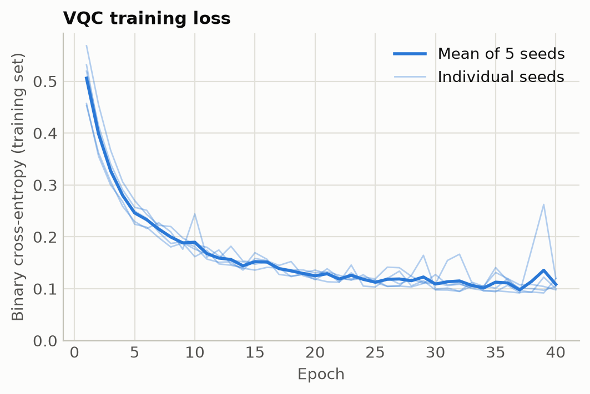

*Figure 8. Training loss of the VQC for the five initialisations.*

### 5.3 Confusion matrices and ROC curves

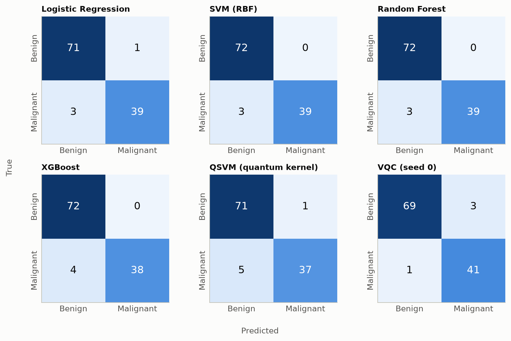

*Figure 9. Confusion matrices on the test set. The VQC panel is seed 0.*

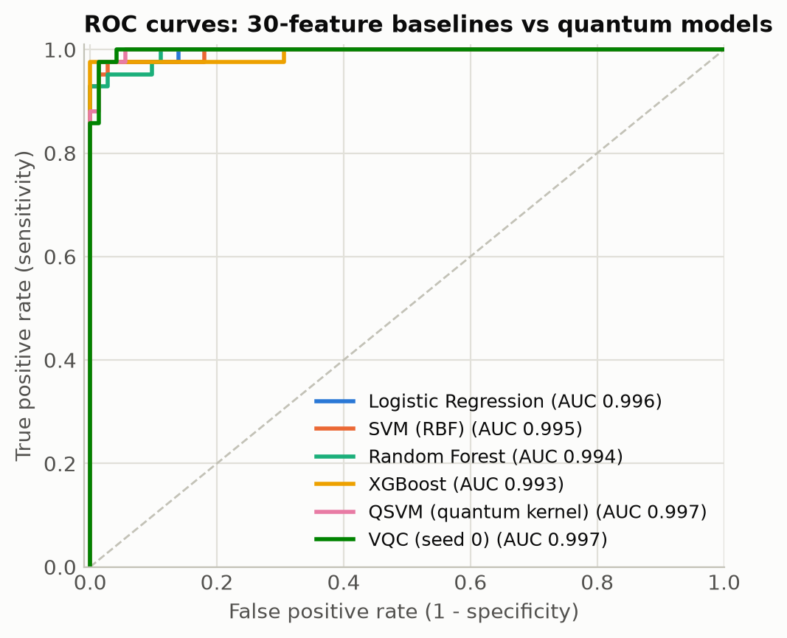

*Figure 10. ROC curves: 30-feature classical baselines and the quantum models.*

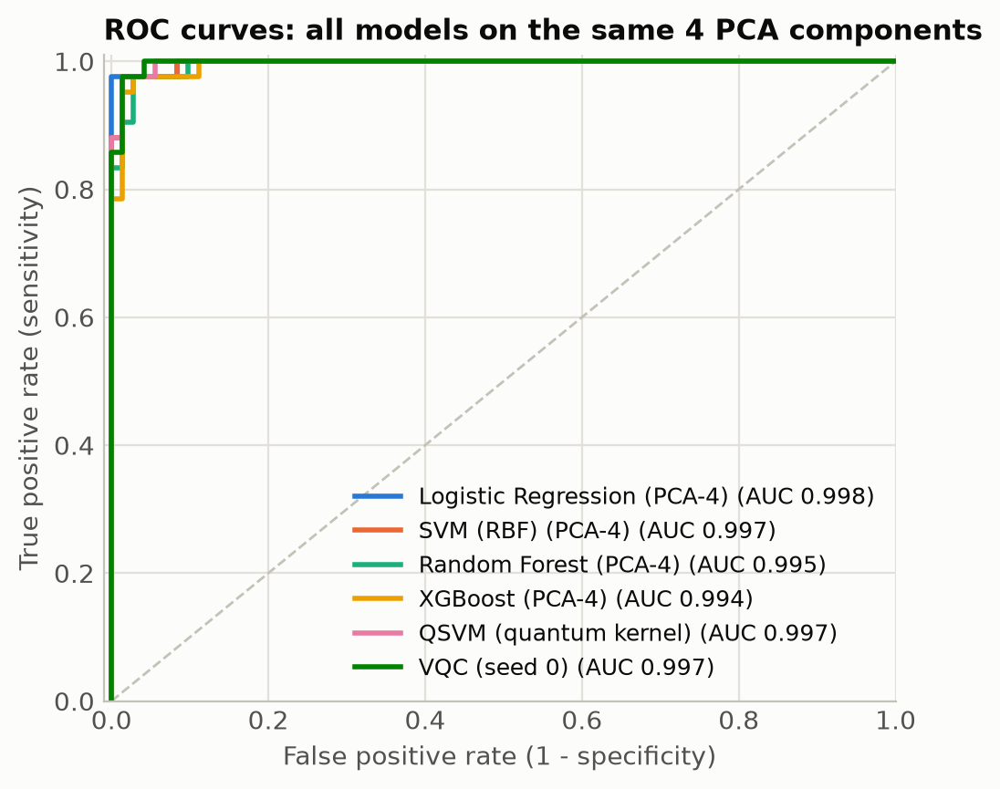

*Figure 11. ROC curves for all models trained on the same four principal components.*

All AUC values lie between 0.993 and 0.998. The classical models on 30 features make almost no false-positive errors (0 or 1) and miss three or four cancers.

### 5.4 Ablation: circuit depth and encoding strategy

To avoid touching the test set, the ablation holds out 25% of the training set (114 samples) for validation and trains on the remaining 341 for 30 epochs, with three seeds per configuration.

**Table 3.** Validation accuracy (mean ± s.d. over three seeds).

| Layers L | Parameters | Single encoding | Data re-uploading |
|---|---|---|---|
| 1 | 14 | 0.716 ± 0.008 | 0.716 ± 0.008 |
| 2 | 26 | 0.944 ± 0.018 | 0.968 ± 0.008 |
| 3 | 38 | 0.962 ± 0.015 | 0.982 ± 0.000 |
| 4 | 50 | 0.971 ± 0.008 | 0.942 ± 0.011 |

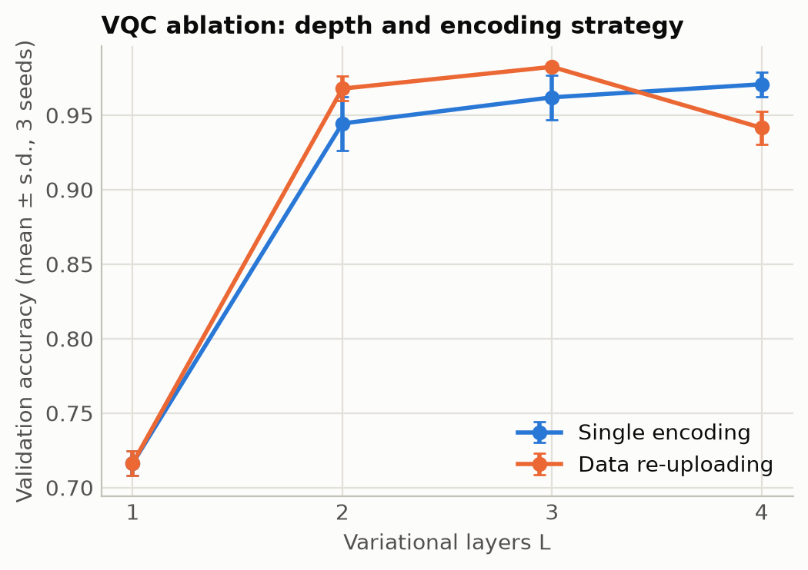

*Figure 12. Validation accuracy against circuit depth for both encoding strategies.*

**Why one layer fails.** With $L = 1$ the accuracy (0.716) is barely above the majority-class rate (0.627). This has an exact explanation. In the Heisenberg picture the measured observable is propagated backwards through the CNOT ring, using $\mathrm{CNOT}^\dagger\, Z_{\text{target}}\, \mathrm{CNOT} = Z_{\text{control}} Z_{\text{target}}$ and $\mathrm{CNOT}^\dagger\, Z_{\text{control}}\, \mathrm{CNOT} = Z_{\text{control}}$:

$$
Z_0 \;\xrightarrow{\mathrm{CNOT}_{3,0}}\; Z_0 Z_3
\;\xrightarrow{\mathrm{CNOT}_{2,3}}\; Z_0 Z_2 Z_3
\;\xrightarrow{\mathrm{CNOT}_{1,2}}\; Z_0 Z_1 Z_2 Z_3
\;\xrightarrow{\mathrm{CNOT}_{0,1}}\; Z_1 Z_2 Z_3 .
$$

The one-layer model therefore measures the parity $Z_1 Z_2 Z_3$ on a product state, so

$$
f(x) = \prod_{i=1}^{3} \langle Z_i \rangle_{x_i},
$$

and **qubit 0, which carries the first principal component and 44.6% of the variance, does not influence the output at all**. The model is blind to the most informative feature. From $L = 2$ onwards the rotations of the second layer mix the information before the final CNOT ring and accuracy rises to 0.94 to 0.98. (The two columns coincide at $L = 1$ because the two circuits are then identical.)

**Depth and re-uploading.** Beyond two layers the differences are small relative to the seed-to-seed spread and to the resolution of a 114-sample validation set (0.88 points per sample). Data re-uploading gives the best single configuration (0.982 at $L = 3$) but is worse at $L = 4$; no monotonic benefit of depth or of re-uploading can be concluded from this experiment.

---

## 6. Extensions: Reliability, Robustness and Explainability

A model that is to support a clinical decision must do more than score well once. This section asks three further questions of the VQC: can its sensitivity be made dependable, would it survive on imperfect hardware, and can it say why it reached a decision? All results are produced by `run_extensions.py`.

### 6.1 Ensemble and sensitivity-calibrated threshold

Section 5.2 showed that the VQC's sensitivity at the default threshold of 0.5 depends on its random initialisation. Two standard remedies are applied.

**Ensemble.** The five independently initialised circuits are combined by averaging their logits,

$$
P_{\text{ens}}(y=1\mid x) = \sigma\!\left(\frac{1}{M}\sum_{m=1}^{M}\big[a_m f_m(x) + b_m\big]\right), \qquad M = 5,
$$

which removes the dependence on any single seed.

**Calibrated threshold.** Instead of 0.5, the decision threshold $\tau$ is chosen for a target sensitivity of 98%. To keep the test set untouched, $\tau$ is set on *out-of-fold* predictions: the training set is split into five folds, an ensemble is trained on four and predicts the fifth, so that every training patient receives a prediction from a model that never saw it. $\tau$ is the largest value at which at least 98% of the training cancers are detected. This gives $\tau = 0.26$ for the VQC ensemble. The identical procedure applied to logistic regression on 30 features gives $\tau = 0.21$.

**Table 4.** Operating points on the test set (42 malignant, 72 benign).

| Model | Threshold | Sensitivity | Specificity | Accuracy | Missed cancers | False alarms |
|---|---|---|---|---|---|---|
| VQC, seed 0 | 0.5 | 0.976 | 0.958 | 0.965 | 1 | 3 |
| VQC, seed 1 | 0.5 | 0.881 | 1.000 | 0.956 | 5 | 0 |
| VQC, seed 2 | 0.5 | 0.929 | 0.986 | 0.965 | 3 | 1 |
| VQC, seed 3 | 0.5 | 0.952 | 0.986 | 0.974 | 2 | 1 |
| VQC, seed 4 | 0.5 | 0.786 | 1.000 | 0.921 | 9 | 0 |
| VQC ensemble | 0.5 | 0.905 | 0.986 | 0.956 | 4 | 1 |
| **VQC ensemble** | **0.26 (calibrated)** | **0.976** | 0.958 | 0.965 | **1** | 3 |
| Logistic regression | 0.5 | 0.929 | 0.986 | 0.965 | 3 | 1 |
| Logistic regression | 0.21 (calibrated) | 0.976 | 0.958 | 0.965 | 1 | 3 |

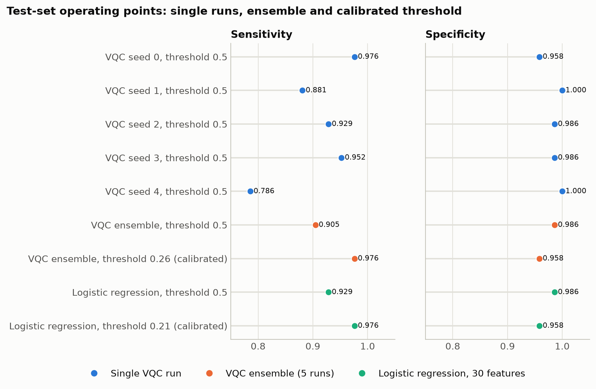

*Figure 13. Sensitivity and specificity for single runs, the ensemble and the calibrated thresholds.*

The ensemble alone does not raise sensitivity: at threshold 0.5 it behaves like an average run (0.905) while removing the seed lottery. The calibrated threshold does: missed cancers fall from four to one, at the price of two further false alarms, and the result (0.976) lands within one patient of the 98% target. At this operating point the quantum ensemble and the classical model are **identical** on the test set: one missed cancer and three false alarms each. The apparent sensitivity deficit of the VQC in Table 1 was therefore a matter of where the threshold sat, not of the model's ability to separate the classes, consistent with its AUC of 0.998.

### 6.2 Robustness to hardware noise

All results so far assume a perfect quantum computer. Two imperfections of real devices are now simulated on the trained circuits, without retraining them.

**Gate errors.** After every gate a depolarising channel is applied,

$$
\mathcal{E}_p(\rho) = (1-p)\,\rho + \frac{p}{3}\big(X\rho X + Y\rho Y + Z\rho Z\big),
$$

with error rate $p$ after each qubit of a CNOT and $p/10$ after single-qubit gates, reflecting the roughly tenfold gap between two-qubit and single-qubit gate fidelities on current devices. The circuit is simulated exactly with density matrices. Current hardware has CNOT error rates of order 0.1% to 1%.

**Table 5.** Effect of gate errors on the test set (mean over the five circuits). "Signal retained" is the spread of $\langle Z_0\rangle$ across patients relative to the noiseless circuit.

| CNOT error | Accuracy, read-out as trained | Accuracy, read-out recalibrated | ROC AUC | Signal retained |
|---|---|---|---|---|
| 0 | 0.956 | 0.961 | 0.997 | 100% |
| 0.5% | 0.958 | 0.961 | 0.997 | 87% |
| 1% | 0.958 | 0.961 | 0.997 | 76% |
| 2% | 0.951 | 0.961 | 0.997 | 57% |
| 5% | 0.940 | 0.961 | 0.997 | 24% |
| 10% | 0.742 | 0.954 | 0.996 | 5% |
| 20% | 0.474 | 0.935 | 0.991 | 0.2% |

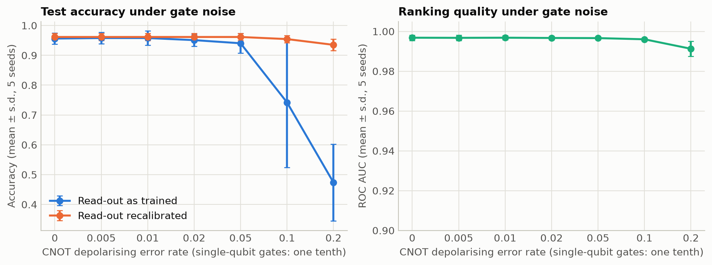

*Figure 14. Accuracy and AUC against the gate error rate.*

Used as trained, the model degrades slowly up to 5% error and then collapses, falling below chance at 20%. Yet the AUC barely moves: 0.997 without noise, 0.996 at 10% error. Depolarising noise contracts every output towards zero by a common factor, $\langle Z_0\rangle_{\text{noisy}} \approx \lambda\,\langle Z_0\rangle$ with $\lambda < 1$, so the *order* of the patients is preserved while the classical read-out $\sigma(a f + b)$, fitted for the noiseless scale, is no longer correct.

The remedy is purely classical. Refitting only the two read-out parameters $(a, b)$ on the noisy outputs of the training set, leaving the 36 circuit weights untouched, restores the accuracy to 0.961 at 5% error and 0.954 at 10%. **Gate noise of this kind damages calibration, not discrimination.**

**Finite shots.** The price of noise is paid elsewhere. On hardware $\langle Z_0\rangle$ is estimated from $N$ repetitions of the circuit, with statistical error of about $1/\sqrt{N}$. When noise shrinks the signal by $\lambda$, resolving it needs about $1/\lambda^2$ times as many repetitions.

**Table 6.** Test accuracy against shots per patient, with recalibrated read-out (mean over five circuits and 200 repetitions).

| Shots | No gate noise | CNOT error 2% | CNOT error 5% |
|---|---|---|---|
| 10 | 0.825 | 0.714 | 0.594 |
| 30 | 0.902 | 0.817 | 0.661 |
| 100 | 0.940 | 0.904 | 0.769 |
| 300 | 0.954 | 0.940 | 0.863 |
| 1000 | 0.960 | 0.955 | 0.926 |
| 3000 | 0.962 | 0.960 | 0.949 |

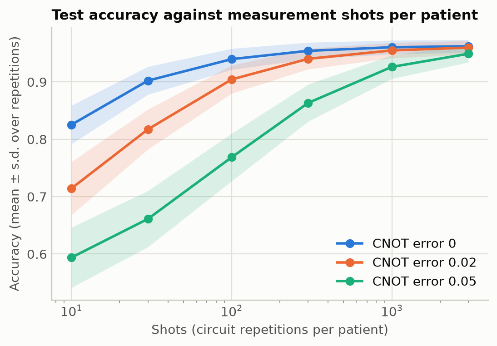

*Figure 15. Accuracy against the number of shots for three gate-error levels.*

A noiseless device reaches 0.95 accuracy with about 300 shots per patient; at 2% CNOT error about 1000 are needed, and at 5% error 3000 shots are still marginally short. Noise converts into measurement cost.

*Scope.* Depolarising noise is a simplified model. Real devices also have coherent errors, crosstalk, read-out errors and drift, which need not preserve the ranking in the same way. These results indicate what to expect, and do not replace a hardware experiment.

### 6.3 Explainability

To explain a prediction we attribute the ensemble's logit $F(x)$ to the 30 original measurements with integrated gradients [17]. With the average training patient $\bar{x}$ as reference, the attribution of feature $j$ is

$$
\phi_j(x) = (x_j - \bar{x}_j)\int_0^1 \frac{\partial F}{\partial x_j}\Big(\bar{x} + t\,(x - \bar{x})\Big)\,dt ,
$$

evaluated numerically with 64 steps. The gradient is obtained by the chain rule through the pipeline: the map from features to rotation angles is linear (standardisation, PCA, rescaling), and the derivative of the circuit output with respect to each angle follows exactly from the parameter-shift rule of Section 4.4, since each angle enters through a single RY gate. The explanation therefore requires only circuit evaluations and could be computed on hardware.

Integrated gradients satisfy *completeness*: $\sum_j \phi_j(x) = F(x) - F(\bar{x})$, so the attributions account for the whole prediction. Numerically the two sides agree to within $2.4\times10^{-4}$ logit units for every test patient. Positive $\phi_j$ pushes towards malignant.

**Global view.** Averaging $|\phi_j|$ over the test set and grouping the mean, error and worst variants of each of the ten nucleus properties gives each property's share of the total attribution (Figure 16). For comparison, logistic regression on 30 features admits exact attributions $\phi_j = w_j (x_j - \bar{x}_j)/\sigma_j$.

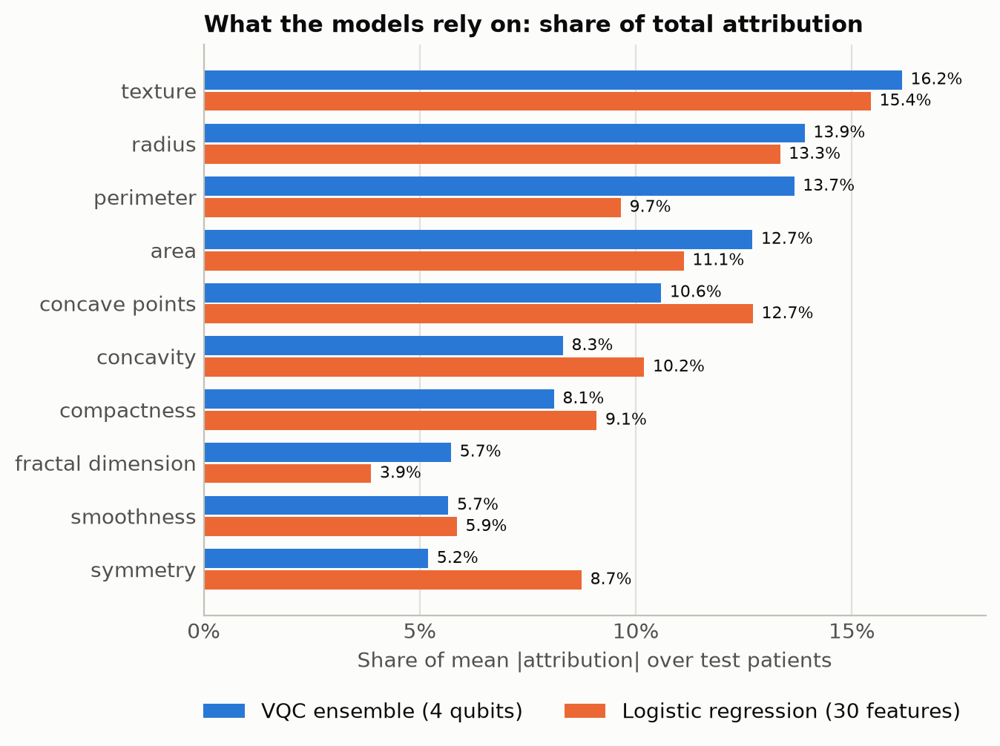

*Figure 16. Share of total attribution by nucleus property for the quantum ensemble and logistic regression.*

Both models rank texture first (16.2% and 15.4%), and the size descriptors radius, perimeter and area together carry 40.3% for the VQC and 34.1% for logistic regression. The ordering of the ten properties agrees well (Spearman $\rho = 0.87$). At the level of the 30 individual features the agreement is weaker ($\rho = 0.36$, $p = 0.054$). This is expected: the features are highly collinear (Figure 3), so a linear model's weight among near-duplicate features is somewhat arbitrary, whereas the VQC sees the data only through principal components and necessarily spreads its attribution evenly across correlated features. The quantum model relies on the same clinical properties as the classical one, which is evidence that it has learned the diagnostic signal and not an artefact.

**Local view.** Figure 17 explains a single borderline patient, a cancer to which the ensemble assigns $P = 0.41$.

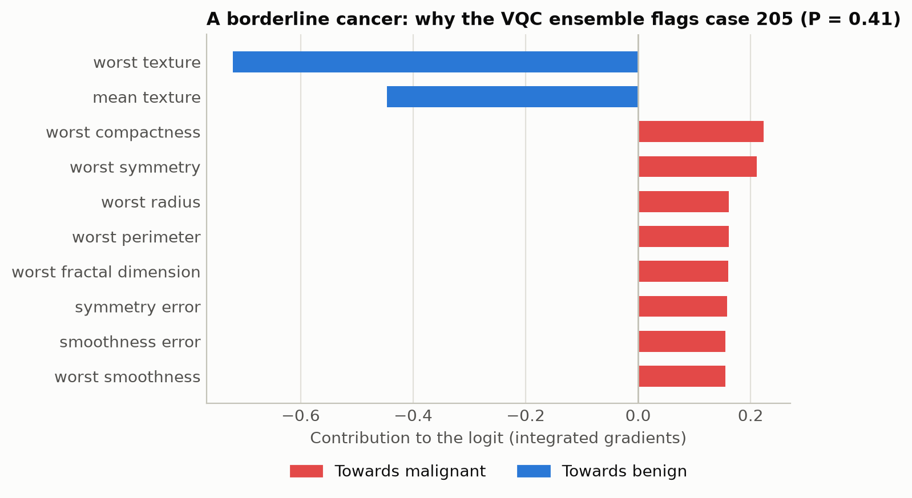

*Figure 17. Attributions for test case 205, the detected cancer with the lowest predicted probability.*

The texture of this patient's nuclei is below average and argues strongly for benign, while compactness, symmetry and size argue for malignant. The evidence is split, the probability falls below 0.5, and the uncalibrated model would have missed this cancer; the calibrated threshold of 0.26 catches it. An explanation of this kind tells a clinician not only what the model predicts but that the case is contested and on what grounds.

*Scope.* Attributions describe the model, not the biology, and depend on the chosen reference patient. They were not validated against expert judgement.

### 6.4 Confirmation without the test set

Sections 6.1 and 6.2 select nothing on the test set: the threshold comes from out-of-fold training predictions and the read-out is refitted on training outputs. Both are nevertheless *reported* on one test set of 114 patients that the whole study has looked at repeatedly. As a check, `run_validation_check.py` repeats both procedures without touching the test set. The 455 training patients are split into fit (60%, train the circuits), calibration (20%, choose the threshold and refit the noisy read-out) and validation (20%, report), five times with different random splits. Each validation split holds 34 cancers and 57 benign cases, 170 and 285 over the five.

**Table 7.** Validation results pooled over five splits (170 cancers, 285 benign).

| Model | Threshold | Sensitivity (mean ± s.d.) | Specificity (mean ± s.d.) | Missed cancers | False alarms |
|---|---|---|---|---|---|
| VQC ensemble | 0.5 | 0.900 ± 0.026 | 0.993 ± 0.010 | 17 | 2 |
| VQC ensemble | calibrated | 0.971 ± 0.036 | 0.832 ± 0.184 | 5 | 48 |
| Logistic regression | 0.5 | 0.929 ± 0.049 | 0.989 ± 0.010 | 12 | 3 |
| Logistic regression | calibrated | 0.947 ± 0.060 | 0.839 ± 0.220 | 9 | 46 |

**Table 8.** Gate noise on validation data (mean ± s.d. over five splits, read-out refitted on the calibration split).

| CNOT error | Accuracy, read-out as trained | Accuracy, read-out recalibrated | ROC AUC |
|---|---|---|---|
| 0 | 0.953 ± 0.013 | 0.956 ± 0.013 | 0.994 ± 0.005 |
| 5% | 0.944 ± 0.012 | 0.956 ± 0.012 | 0.993 ± 0.006 |
| 10% | 0.821 ± 0.060 | 0.953 ± 0.011 | 0.993 ± 0.006 |

*Noise recalibration is confirmed.* At 10% CNOT error the accuracy falls to 0.821 as trained and returns to 0.953 after refitting the two read-out parameters, with the AUC unchanged, in every split.

*Threshold calibration is confirmed in direction but not in cost.* Sensitivity rises from 0.900 to 0.971 (17 missed cancers become 5), but specificity falls from 0.993 to 0.832 (2 false alarms become 48), far more than the two extra false alarms seen on the test set. The chosen threshold is also unstable, ranging from 0.02 to 0.56 across splits; in one split it came out above 0.5 and missed one more cancer than the default. Two things contribute. With only 34 cancers in a calibration split, a 98% target allows no misses, so the threshold is set by the single lowest-scoring cancer, an extreme and noisy statistic; the threshold of Section 6.1 rests on 170 cancers and is better determined. And the test-set figure of Table 4 (one missed cancer, three false alarms) is a single, favourable draw. The claim that survives is the weaker one: lowering the threshold buys sensitivity for both the quantum and the classical model, the two remain comparable, and the price in false alarms is uncertain and depends strongly on how much data the threshold is calibrated on.

---

## 7. Discussion

### 7.1 Answer to the research question

Yes: a four-qubit hybrid model reaches performance competitive with classical models on this task (0.956 ± 0.018 versus 0.974 accuracy; identical AUC within 0.004). It does not exceed them, and there is no reason to expect it to on this dataset.

### 7.2 Why no quantum advantage should be read into these results

- **The problem is easy.** The classes are nearly linearly separable in the first principal components (Figure 5). A logistic regression with five parameters on the same four inputs equals the best model in the study. The VQC uses 38 parameters to reach a slightly lower mean accuracy.
- **The circuit is classically trivial.** Four qubits correspond to a 16-dimensional state vector; the simulation is exact and takes milliseconds. Nothing here is hard to compute classically.
- **The differences are not statistically resolvable.** For an accuracy near 0.96 on 114 samples the binomial standard error is about 1.8 percentage points, so a 95% interval is roughly ±3.6 points. Every model in Table 1 lies within every other model's interval.

### 7.3 Limitations

1. **Small, single-centre dataset.** 569 patients from one institution collected around 1990; a single test split of 114. Results may not transfer to other populations, imaging devices or cytology protocols. No external validation was performed.
2. **Unsupervised dimensionality reduction.** PCA discards 21% of the variance without regard to the label. It happened to preserve the signal here, but in general the qubit budget forces a compression that classical models do not need.
3. **Simulated, simplified noise.** The headline results are noiseless. Section 6.2 adds depolarising gate errors and shot noise, but not coherent errors, crosstalk, read-out errors or drift, and nothing was run on a real device.
4. **Sensitivity to initialisation.** Recall varied between 0.79 and 0.98 across seeds at a fixed threshold. Ensembling and threshold calibration (Section 6.1) remove this on the present test set, but the calibrated sensitivity rests on 42 malignant test cases, where one patient is 2.4 percentage points, and the validation check of Section 6.4 shows that the calibrated threshold is unstable and can cost many more false alarms than the test set suggests.
5. **Fixed hyperparameters.** The classical baselines use default settings and the VQC architecture was fixed in advance. Tuning might shift individual numbers by a point or two, though not the overall conclusion.
6. **One operating point.** Table 1 classifies at probability 0.5 and Section 6.1 examines a single alternative (98% target sensitivity). The acceptable trade-off between missed cancers and false alarms is a clinical decision that this study does not make.
7. **Training cost.** The VQC takes about 20 seconds to train in simulation, against milliseconds for logistic regression, and simulation cost grows exponentially with qubit number.

### 7.4 Research gaps

- **Scalability and trainability.** Gradients of randomly initialised deep circuits vanish exponentially with qubit number (barren plateaus [15]). Whether trainable circuits remain useful beyond classically simulable sizes is unresolved.
- **Data encoding.** Angle encoding needs one qubit per feature. Amplitude encoding stores $2^n$ features in $n$ qubits but requires deep state-preparation circuits. Encodings matched to the structure of biomedical data are largely unexplored.
- **Kernel concentration.** Fidelity kernels tend towards the identity as qubit number grows [14], which demands exponentially many shots; bandwidth tuning mitigates but does not remove this.
- **Where could an advantage come from?** Theory indicates advantage requires data whose structure a quantum feature map captures and classical kernels cannot [8]. Tabular clinical features give no obvious reason for such structure; data of quantum origin (molecular or spectroscopic) may.
- **Interpretability.** Clinical use requires explanations. Section 6.3 shows that gradient-based attribution carries over to a hybrid pipeline, but whether such explanations agree with expert reasoning, and how they behave under hardware noise, is untested.
- **Benchmarking standards.** Many QML studies report single runs on small test sets without like-for-like classical baselines [7]; the field needs the protocol used here as a minimum.

---

## 8. Conclusion

We built and evaluated a hybrid quantum-classical pipeline for breast cancer classification. A four-qubit variational quantum classifier with 38 parameters, simulated without noise, achieved 0.956 ± 0.018 test accuracy and 0.997 AUC, and a quantum-kernel SVM achieved 0.947 and 0.997. Classical models reached up to 0.974. On identical four-dimensional inputs, quantum and classical models are statistically indistinguishable.

Beyond the headline numbers the study yields three findings. First, the VQC's discrimination is stable across initialisations while its calibration is not, so single-run sensitivity figures are unreliable. Second, the one-layer circuit fails for an identifiable structural reason: the CNOT ring maps the measured observable onto qubits that exclude the dominant feature. Third, most of the diagnostic information survives reduction to four principal components.

Three extensions address clinical readiness. An ensemble of five circuits with a threshold calibrated on out-of-fold predictions detects 41 of 42 test cancers with three false alarms, exactly matching a classical model calibrated the same way; a repeat on validation splits confirms the gain in sensitivity but at a much higher and less predictable cost in false alarms. Under simulated depolarising gate noise the ranking of patients is almost unaffected (AUC 0.996 at 10% CNOT error) while the trained read-out fails; refitting two classical parameters restores accuracy, and the remaining cost of noise is a larger number of measurement shots. Integrated-gradient attributions, computed with the parameter-shift rule, show that the quantum model relies on the same nucleus properties as logistic regression.

The appropriate conclusion is that small quantum models can *match* classical ones on an easy medical task in simulation, not that they offer an advantage.

---

## 9. Future Work

1. **Real hardware.** Run the trained circuits on a quantum device with error mitigation, to test whether the predictions of Section 6.2 (ranking preserved, read-out recalibration sufficient) hold under realistic noise.
2. **Validated explanations.** Compare the attributions of Section 6.3 with SHAP values and with the judgement of pathologists, and study their stability under noise, towards an *explainable hybrid quantum neural network for breast cancer diagnosis*.
3. **Noise-aware training.** Train the circuit with noise in the loop, and choose the threshold jointly with the shot budget.
4. **Supervised compression.** Replace PCA by a trainable classical encoder (a small neural network trained jointly with the circuit) or by supervised feature selection.
5. **Architectures.** Six and eight qubits, amplitude encoding, quantum convolutional networks, and trainable (aligned) quantum kernels.
6. **Robust statistics.** Repeated stratified cross-validation over the whole dataset with paired significance tests (e.g. McNemar), and external validation on an independent cohort.
7. **Harder data.** Histopathology or mammography images, and multi-omics data, where classical baselines are less saturated.

---

## Reproducibility

```bash
pip install -r requirements.txt
python run_experiment.py     # Sections 2 to 5
python run_extensions.py     # Sections 6.1 to 6.3
python run_validation_check.py   # Section 6.4
streamlit run app.py         # interactive demo
```

Software: Python 3.14, PennyLane 0.45 [16], scikit-learn 1.9 [9], XGBoost 3.4. All random seeds are fixed in `qmlbc/config.py`.

---

## References

[1] W. N. Street, W. H. Wolberg, O. L. Mangasarian, "Nuclear feature extraction for breast tumor diagnosis," *Proc. SPIE 1905, Biomedical Image Processing and Biomedical Visualization*, 861–870 (1993).

[2] M. Benedetti, E. Lloyd, S. Sack, M. Fiorentini, "Parameterized quantum circuits as machine learning models," *Quantum Science and Technology* 4, 043001 (2019).

[3] K. Mitarai, M. Negoro, M. Kitagawa, K. Fujii, "Quantum circuit learning," *Physical Review A* 98, 032309 (2018).

[4] M. Schuld, A. Bocharov, K. M. Svore, N. Wiebe, "Circuit-centric quantum classifiers," *Physical Review A* 101, 032308 (2020).

[5] V. Havlíček, A. D. Córcoles, K. Temme, A. W. Harrow, A. Kandala, J. M. Chow, J. M. Gambetta, "Supervised learning with quantum-enhanced feature spaces," *Nature* 567, 209–212 (2019).

[6] M. Schuld, N. Killoran, "Quantum machine learning in feature Hilbert spaces," *Physical Review Letters* 122, 040504 (2019).

[7] J. Bowles, S. Ahmed, M. Schuld, "Better than classical? The subtle art of benchmarking quantum machine learning models," arXiv:2403.07059 (2024).

[8] H.-Y. Huang, M. Broughton, M. Mohseni, R. Babbush, S. Boixo, H. Neven, J. R. McClean, "Power of data in quantum machine learning," *Nature Communications* 12, 2631 (2021).

[9] F. Pedregosa et al., "Scikit-learn: Machine learning in Python," *Journal of Machine Learning Research* 12, 2825–2830 (2011).

[10] M. Schuld, V. Bergholm, C. Gogolin, J. Izaac, N. Killoran, "Evaluating analytic gradients on quantum hardware," *Physical Review A* 99, 032331 (2019).

[11] M. Schuld, R. Sweke, J. J. Meyer, "Effect of data encoding on the expressive power of variational quantum machine-learning models," *Physical Review A* 103, 032430 (2021).

[12] A. Pérez-Salinas, A. Cervera-Lierta, E. Gil-Fuster, J. I. Latorre, "Data re-uploading for a universal quantum classifier," *Quantum* 4, 226 (2020).

[13] R. Shaydulin, S. M. Wild, "Importance of kernel bandwidth in quantum machine learning," *Physical Review A* 106, 042407 (2022).

[14] S. Thanasilp, S. Wang, M. Cerezo, Z. Holmes, "Exponential concentration in quantum kernel methods," *Nature Communications* 15, 5200 (2024).

[15] J. R. McClean, S. Boixo, V. N. Smelyanskiy, R. Babbush, H. Neven, "Barren plateaus in quantum neural network training landscapes," *Nature Communications* 9, 4812 (2018).

[16] V. Bergholm et al., "PennyLane: Automatic differentiation of hybrid quantum-classical computations," arXiv:1811.04968 (2018).

[17] M. Sundararajan, A. Taly, Q. Yan, "Axiomatic attribution for deep networks," *Proceedings of the 34th International Conference on Machine Learning (ICML)*, PMLR 70, 3319–3328 (2017).
