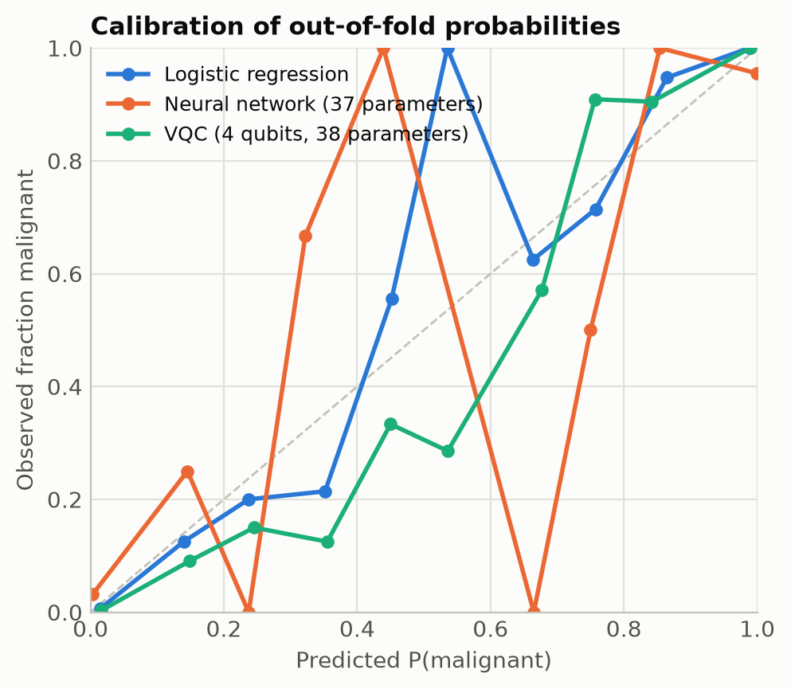
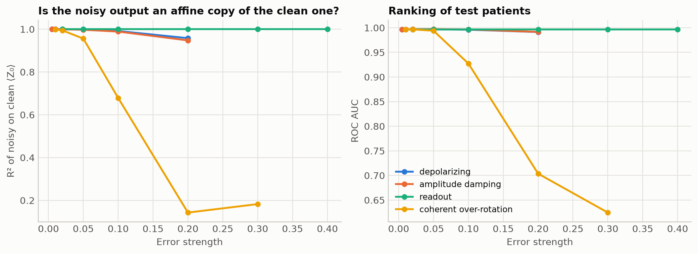
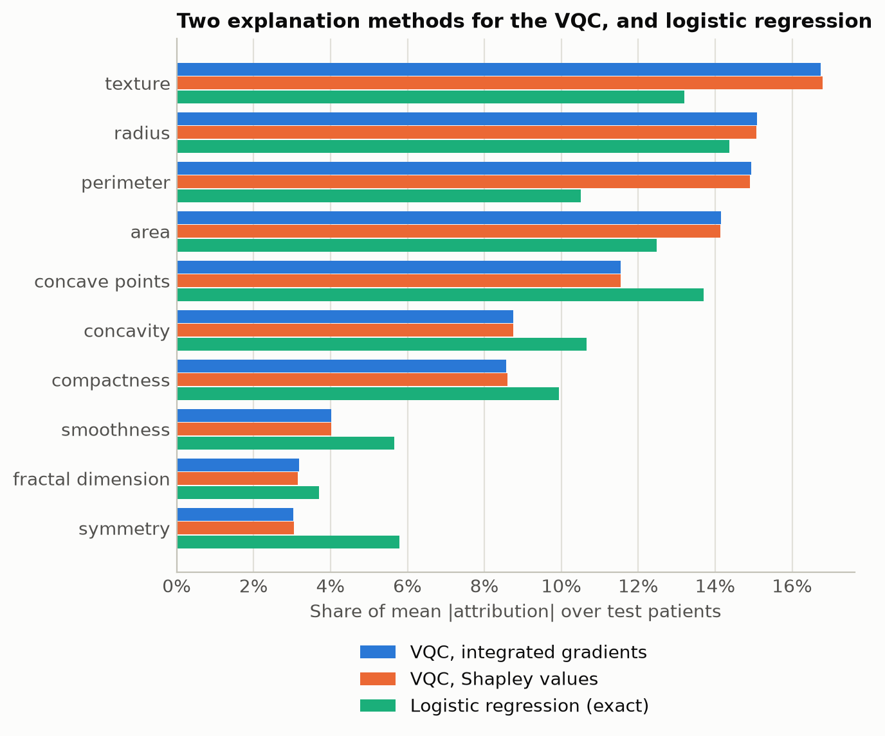
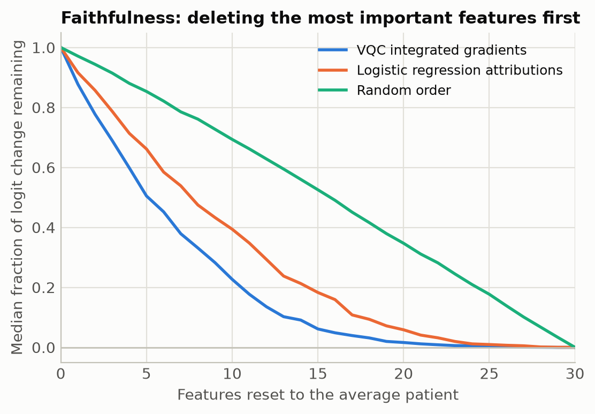
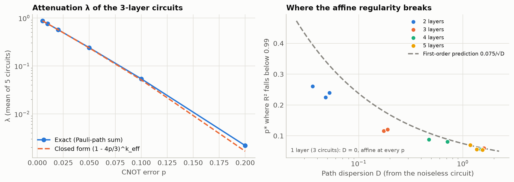

# Hybrid Quantum-Classical Machine Learning Approach for Breast Cancer Classification Using a Variational Quantum Classifier

**Abdullah Mahmood**

*All numbers, tables and figures in this document are produced by `run_experiment.py` in this repository and can be regenerated with one command.*

---

## Abstract

We study whether a small hybrid quantum-classical model can match classical machine learning on breast cancer diagnosis, and what it would take to trust it. On the Breast Cancer Wisconsin (Diagnostic) dataset (569 patients, 30 features) reduced to four principal components, a four-qubit variational quantum classifier (VQC, RY angle encoding, three RX-RY-RZ + CNOT layers, 38 parameters) and a quantum-kernel SVM (QSVM) are compared with tuned classical models on the same inputs, a classical neural network with the same number of parameters, and logistic regression on all 30 features. In 5-fold cross-validation repeated three times over all patients, the VQC reaches an AUC of 0.993 ± 0.005 and an accuracy of 0.960 ± 0.012, statistically indistinguishable from tuned logistic regression, RBF-SVM and the QSVM on the same four inputs (all AUC differences below 0.001; corrected resampled t-tests with Holm adjustment). Near this ceiling AUC cannot separate models, and sensitivity measured on 42 test cancers carries a 95% interval 12 to 18 percentage points wide; comparing models at fixed 95% specificity removes the threshold from the comparison and again shows no difference. Three further analyses examine reliability, robustness and explainability. An ensemble of five circuits with a threshold calibrated for 98% sensitivity reaches 0.976 sensitivity on the test set and on five validation splits, at a specificity of 0.91 on the latter. Under simulated hardware noise the trained read-out fails (accuracy 0.74 at 10% CNOT error) while the ranking of patients survives (AUC 0.996); we show that the noisy circuit output is an affine copy of the noiseless one for depolarising, amplitude-damping and read-out errors (R² ≥ 0.99), which explains why refitting two classical read-out parameters restores accuracy and why the number of measurement shots needed grows as 1/λ², confirmed by a collapse of accuracy curves onto N·λ². Coherent over-rotation errors break the affine relation and the recovery, as predicted. An exact Pauli-path decomposition derives the regularity from circuit structure and predicts, from the noiseless circuit alone, where it breaks; as predicted, it breaks earlier in deeper circuits (Spearman ρ = −0.92 between depth and breakdown point over 15 circuits). Explanations computed on the quantum model itself (integrated gradients via the parameter-shift rule, exact Shapley values) agree with each other, are faithful in deletion tests and stable across circuits, but only partly pass a weight-randomisation sanity check, because feature-level explanations of this pipeline have only four degrees of freedom set by the circuit. A closely related 2026 study already reports a VQC benchmark, noise stress tests and explainability on the same dataset; the contribution here is the separation of discrimination from calibration under noise, the tested mechanism behind it, and explanation checks on the quantum model itself. No quantum advantage is claimed or observed.

---

## 1. Introduction

Breast cancer is the most frequently diagnosed cancer in women, and distinguishing malignant from benign masses early is central to treatment outcome. Fine-needle aspiration cytology yields digitised images of cell nuclei from which shape and texture descriptors can be computed, and classical machine learning on these descriptors has long achieved accuracies above 95% [1].

Quantum machine learning (QML) proposes to use parameterised quantum circuits as trainable models [2, 3]. Data are mapped into the exponentially large Hilbert space of a qubit register, processed by a circuit whose gate angles are trained by a classical optimiser, and read out by measurement. Such a model is *hybrid*: the quantum processor evaluates a function, the classical computer optimises it. Two families dominate: variational classifiers, which train the circuit directly [3, 4], and quantum kernel methods, which use the circuit only to compute similarities between data points [5, 6].

Whether these models offer any practical benefit on real tabular data is an open question. Careful benchmarking has shown that reported gains often vanish under like-for-like comparison [7], and theory indicates that an advantage requires data with structure that the quantum feature map can exploit and classical models cannot [8].

**Research question.** Can a hybrid quantum-classical model achieve competitive classification performance for breast cancer diagnosis when compared fairly with classical models?

It is broken into four questions, each answered in its own section:

- **Q1 (performance).** On identical inputs and under equal treatment, does the VQC differ from classical models in discrimination, accuracy or calibration? (Sections 5, 7.1, 7.2)
- **Q2 (reliability).** Can the VQC's dependence on its random initialisation and its decision threshold be controlled? (Sections 5.2, 6.1, 6.4)
- **Q3 (robustness).** What does hardware noise do to the classifier, and why? (Sections 6.2, 7.3)
- **Q4 (explainability).** Can the quantum model's predictions be explained, and how far can the explanations be trusted? (Sections 6.3, 7.4)

**Contributions.**

1. A complete, reproducible pipeline from raw data to results, in which every preprocessing step is fitted on training data only.
2. A like-for-like comparison: classical models are evaluated both on all 30 features and on exactly the four principal components the quantum models receive, separating the cost of dimensionality reduction from the effect of the model.
3. Reporting of the VQC over several random initialisations, not a single run.
4. An ablation over circuit depth and encoding strategy, including an analytical explanation of the failure of the one-layer circuit.
5. Three extensions aimed at clinical readiness: an ensemble with a sensitivity-calibrated threshold, a study of gate and shot noise with a classical read-out recalibration, and per-patient explanations by integrated gradients evaluated with the parameter-shift rule.
6. A repeated cross-validation comparison with tuned classical models, a parameter-matched neural network and a classical model spanning the VQC's exact function class (81 trigonometric features), with corrected significance tests, confidence intervals and calibration measures.
7. A tested mechanism for the noise result: the noisy circuit output is an affine function of the noiseless one for three error models and not for a fourth, which predicts when read-out recalibration works and how the shot cost scales.
8. Validity checks of the explanations computed on the quantum model itself: agreement with exact Shapley values, deletion tests, a weight-randomisation sanity check and stability across circuits.
9. An exact Pauli-path decomposition of the noisy classifier output, and a path dispersion D computed from the noiseless circuit that predicts where the affine regularity breaks; confirmed on 15 circuits of one to five layers (Spearman ρ = −0.97).

### 1.1 Related work and positioning

Variational and kernel quantum classifiers have been applied to the Wisconsin breast cancer data many times, mostly in conference papers and preprints with single train/test splits. The closest study is that of Zorlu and Colak [18], published in 2026. It benchmarks an eight-qubit PennyLane VQC with RY angle encoding and a ZZ-feature-map QSVM against five classical learners, reports calibration, decision-curve analysis and DeLong-type tests, stress-tests the VQC with single-qubit depolarising noise up to $p = 0.1$ (AUC essentially unchanged at about 0.992), explains the VQC with SHAP computed on a gradient-boosted surrogate, and validates externally on the Wisconsin Original cohort. Benchmarking, AUC robustness to depolarising noise, calibration and explainability on this dataset are therefore not new.

Two further strands are relevant. Integrated gradients and baseline SHAP have been adapted to parameterised quantum circuits [19]. In error mitigation, noise that acts as a global depolarising channel is known to rescale expectation values by a common factor that can be estimated and divided out [20]. Pauli-path expansions of noisy circuits, in which each path is damped by the noise it meets, are an established tool for classically simulating noisy random and variational circuits [25, 26]; Section 7.5 uses the same expansion for a different purpose.

Against this background the present study does not propose a new model. What it adds, as far as the sources above show, is (i) the observation that under noise a quantum classifier keeps its discrimination but loses its decision rule, which AUC-only reporting cannot reveal; (ii) a mechanism for this, tested against four error models including one for which it predicts failure, together with a confirmation for a trained classifier of the known 1/λ² shot overhead of rescaling; (iii) recovery by refitting two read-out parameters on labelled data, without the extra calibration circuits of [20]; (iv) explanations computed on the quantum model itself rather than on a surrogate, with validity checks; (v) a parameter-matched network and a classical model spanning the VQC's exact function class (81 trigonometric features), with corrected significance tests; and (vi) a structural criterion, the path dispersion, that predicts from the noiseless circuit when Pauli noise stops acting as a common rescaling. A systematic literature search was not carried out, and these points may have precedents in the error-mitigation and quantum-robustness literature that were not found.

---

## 2. Dataset

We use the Breast Cancer Wisconsin (Diagnostic) dataset [1] as distributed with scikit-learn [9].

| Property | Value |
|---|---|
| Samples | 569 |
| Malignant | 212 (37.3%) |
| Benign | 357 (62.7%) |
| Features | 30, real-valued, no missing values |

Ten quantities are measured for each cell nucleus in the image (radius, texture, perimeter, area, smoothness, compactness, concavity, concave points, symmetry, fractal dimension). For each quantity the mean, the standard error and the "worst" value (mean of the three largest) are recorded, giving 30 features.

**Label convention.** scikit-learn encodes malignant as 0 and benign as 1. We flip this so that

$$
y = \begin{cases} 1, & \text{malignant} \\ 0, & \text{benign} \end{cases}
$$

The positive class is then the disease, so that recall equals clinical *sensitivity* (the fraction of cancers detected) and precision equals the positive predictive value.

### Exploratory analysis

The classes are moderately imbalanced (Figure 1), which is why precision, recall and F1 are reported alongside accuracy.


*Figure 1. Class distribution.*

The features most correlated with malignancy are size and concavity descriptors (Figure 2): worst concave points, worst perimeter, mean concave points and worst radius all have a point-biserial correlation above 0.77 with the label.


*Figure 2. The twelve features most correlated with malignancy.*

The features are strongly redundant (Figure 3): radius, perimeter and area are correlated at r ≥ 0.99, as geometry dictates. This redundancy is what makes aggressive dimensionality reduction viable.


*Figure 3. Pearson correlation between the ten mean-value features.*

---

## 3. Methodology

### 3.1 Pipeline

```
30 features ──► stratified 80/20 split ──► StandardScaler ──► PCA (4) ──► rescale to [0, π] ──► quantum circuit ──► prediction
                                           └──────── fitted on training data only ────────┘
```

### 3.2 Train/test split

The data are split once into 455 training samples (170 malignant) and 114 test samples (42 malignant), stratified by class, with a fixed random seed. The test set is used only for the final evaluation. Model selection (the QSVM hyperparameters and the ablation study) uses cross-validation or a validation split *inside* the training set.

### 3.3 Preprocessing and avoiding leakage

Each feature is standardised, $x_j \leftarrow (x_j - \mu_j)/\sigma_j$, because the features span several orders of magnitude (area ~ 10³, smoothness ~ 10⁻¹) and both PCA and gradient-based training are scale sensitive.

All transforms (standardisation, PCA, angle rescaling) are implemented as steps of a scikit-learn `Pipeline` together with the classifier. Their parameters are therefore estimated from the training fold only, also within cross-validation. Fitting them on the full dataset would leak test-set statistics into training and bias the results optimistically.

### 3.4 Dimensionality reduction

A simulated or real quantum circuit with angle encoding needs one qubit per feature, and current devices offer few reliable qubits. We therefore project the standardised data onto the first $n = 4$ principal components,

$$
z = W^\top \tilde{x}, \qquad W \in \mathbb{R}^{30 \times 4},
$$

where the columns of $W$ are the leading eigenvectors of the training covariance matrix. The four components explain 44.6%, 18.5%, 9.6% and 6.6% of the variance, 79.3% in total (Figure 4). The two classes are already largely separated along the first component (Figure 5).


*Figure 4. Cumulative explained variance.*


*Figure 5. Training set in the first two principal components.*

PCA is unsupervised: it keeps directions of high variance, which need not be the most discriminative ones. This is a limitation discussed in Section 8.3.

### 3.5 Classical baselines

Four standard models are trained with fixed, conventional hyperparameters: logistic regression, a support vector machine with RBF kernel, a random forest (300 trees) and XGBoost (300 trees, depth 3, learning rate 0.1). Each is trained in two settings:

- **30 features**: the strongest classical reference.
- **4 PCA components**: the same input the quantum models receive. Differences between these models and the quantum models are attributable to the model and not to information lost in PCA.

### 3.6 Evaluation

With TP, TN, FP, FN the entries of the confusion matrix (positive = malignant):

$$
\text{Accuracy}=\frac{TP+TN}{TP+TN+FP+FN}, \qquad
\text{Precision}=\frac{TP}{TP+FP}, \qquad
\text{Recall}=\frac{TP}{TP+FN},
$$

$$
F_1 = 2\,\frac{\text{Precision}\times\text{Recall}}{\text{Precision}+\text{Recall}} .
$$

A false negative (a missed cancer) is clinically far more costly than a false positive, so recall is the metric of primary interest. We also report the area under the ROC curve (AUC), which measures how well the model *ranks* patients independently of the decision threshold, and the 5-fold stratified cross-validation accuracy on the training set.

### 3.7 Evaluation design

Results are reported at three levels, because one test set of 114 patients is both small and, by the end of a study, looked at by many analyses.

1. **Hold-out test set** (Sections 5 and 6.1 to 6.3): 114 patients, used only for reporting; no model, threshold or read-out was chosen on it.
2. **Validation splits inside the training set** (Section 6.4): the 455 training patients split five times into fit, calibration and validation parts, the test set untouched.
3. **Repeated cross-validation over all 569 patients** (Section 7.1): 5 folds × 3 repeats, giving 15 train/test partitions.

Uncertainty is expressed with Wilson score intervals for proportions such as sensitivity [23], stratified bootstrap intervals (2,000 resamples) for AUC and AUC differences, and, for cross-validation, the corrected resampled t-test of Nadeau and Bengio [21], which accounts for the overlap between training sets of different folds. Paired predictions are compared with exact McNemar tests. Families of comparisons are adjusted with the Holm procedure.

**Confirmatory and exploratory analyses.** The comparison of Section 5 was planned before any result was seen. The extensions of Sections 6 and 7 were designed afterwards in response to those results and are exploratory, with one exception: for the noise-mechanism study of Section 7.3 the hypothesis, the quantities that test it and the error model for which it should fail were written into the analysis script before it was run.

---

## 4. Model Architecture

### 4.1 Feature encoding

Each principal component is rescaled linearly to an angle $x_i \in [0, \pi]$ (min-max scaling fitted on the training set, with out-of-range test values clipped). The classical vector is then written into a quantum state by **angle encoding**: one RY rotation per qubit acting on $|0\rangle^{\otimes n}$,

$$
|\psi(x)\rangle = \bigotimes_{i=1}^{n} R_y(x_i)\,|0\rangle
= \bigotimes_{i=1}^{n}\left(\cos\frac{x_i}{2}\,|0\rangle + \sin\frac{x_i}{2}\,|1\rangle\right),
\qquad
R_y(\theta) = e^{-i\theta Y/2} =
\begin{pmatrix}\cos\frac{\theta}{2} & -\sin\frac{\theta}{2}\\ \sin\frac{\theta}{2} & \cos\frac{\theta}{2}\end{pmatrix}.
$$

The range $[0,\pi]$ is chosen because the map $x_i \mapsto R_y(x_i)|0\rangle$ is one-to-one on it: $x_i = 0$ gives $|0\rangle$, $x_i = \pi$ gives $|1\rangle$, and no two feature values produce the same state. The encoded state is a product state; it uses $n$ qubits for $n$ features and a circuit of depth one.

### 4.2 Variational ansatz

The encoded state is processed by $L$ identical layers. Layer $\ell$ applies three single-qubit rotations to every qubit, followed by a ring of CNOT gates:

$$
U_\ell(\theta_\ell) = \underbrace{\left(\prod_{i=1}^{n} \mathrm{CNOT}_{i,\,i+1 \bmod n}\right)}_{\text{entanglement}}
\;\underbrace{\bigotimes_{i=1}^{n} R_z(\theta_{\ell,i,3})\,R_y(\theta_{\ell,i,2})\,R_x(\theta_{\ell,i,1})}_{\text{trainable rotations}},
$$

with $R_P(\theta) = e^{-i\theta P/2}$ for $P \in \{X, Y, Z\}$. The three rotations together can realise any single-qubit unitary; the CNOT gates create entanglement, without which the model would factorise into $n$ independent single-qubit models. The full circuit is

$$
|\phi(x;\theta)\rangle = U_L(\theta_L)\cdots U_1(\theta_1)\,|\psi(x)\rangle .
$$


*Figure 6. The VQC for n = 4 qubits and L = 3 layers.*

| Quantity | Value |
|---|---|
| Qubits | 4 |
| Encoding | RY angle encoding, one feature per qubit |
| Variational layers | 3 |
| Gates per layer | 4 RX, 4 RY, 4 RZ, 4 CNOT |
| Total gates | 4 (encoding) + 36 rotations + 12 CNOT |
| Circuit parameters | 3 × 4 × 3 = 36 |
| Classical read-out parameters | 2 |
| Simulator | PennyLane `default.qubit`, exact state vector (no shot noise) |

### 4.3 Measurement and hybrid read-out

The model output is the expectation value of Pauli-Z on the first qubit,

$$
f(x;\theta) = \langle \phi(x;\theta)|\, Z_0 \,|\phi(x;\theta)\rangle \in [-1, 1].
$$

On hardware this is estimated from repeated measurements as $p(0) - p(1)$ on qubit 0. A classical affine map and sigmoid convert it into a probability:

$$
P(y = 1 \mid x) = \sigma\big(a\, f(x;\theta) + b\big), \qquad \sigma(t) = \frac{1}{1+e^{-t}} .
$$

The scale $a$ and bias $b$ are trained with the circuit. Without $a$, the probability would be confined to $[\sigma(-1), \sigma(1)] = [0.27, 0.73]$ and the model could never be confident. A patient is classified as malignant when $P(y=1\mid x) > 0.5$.

### 4.4 Training

The parameters $(\theta, a, b)$ minimise the binary cross-entropy on the training set,

$$
\mathcal{L}(\theta, a, b) = -\frac{1}{N}\sum_{k=1}^{N}\Big[y_k \log p_k + (1-y_k)\log(1-p_k)\Big], \qquad p_k = P(y=1\mid x_k),
$$

using the Adam optimiser (learning rate 0.05, mini-batches of 32, 40 epochs). Circuit weights are initialised uniformly in $[0, 2\pi)$, with $a = 1$, $b = 0$.

**Gradients.** For a gate $e^{-i\theta P/2}$ with Pauli generator $P$, the derivative of an expectation value is given exactly by the parameter-shift rule [3, 10],

$$
\frac{\partial f}{\partial \theta_j} = \frac{1}{2}\left[f\!\left(\theta_j + \tfrac{\pi}{2}\right) - f\!\left(\theta_j - \tfrac{\pi}{2}\right)\right],
$$

which requires only two further circuit evaluations per parameter and is therefore usable on real hardware. In simulation we obtain the same gradients more cheaply by backpropagation through the state vector.

### 4.5 What function class is this?

A circuit in which each feature enters through a single Pauli rotation is a truncated Fourier series in that feature [11]: $f$ contains only the frequencies $\{-1, 0, 1\}$ in each $x_i$, i.e. it is a multilinear polynomial in $\cos x_i$ and $\sin x_i$. The trainable layers determine the Fourier coefficients but cannot add frequencies. Repeating the encoding before each of the $L$ layers ("data re-uploading" [12]) raises the accessible frequencies to $\{-L,\dots,L\}$ and so enlarges the function class. Both variants are compared in Section 5.4.

### 4.6 Quantum kernel SVM

The second quantum model keeps the circuit fixed and trains nothing inside it. Data are embedded with the IQP-type feature map of Havlíček et al. [5],

$$
|\Phi(x)\rangle = \Big[\,U_Z(x)\,H^{\otimes n}\Big]^{2}|0\rangle^{\otimes n}, \qquad
U_Z(x) = \exp\!\Big(-\tfrac{i}{2}\sum_i x_i Z_i - \tfrac{i}{2}\sum_{i<j} x_i x_j Z_i Z_j\Big),
$$

and similarity between two patients is the state fidelity

$$
k(x, x') = \big|\langle \Phi(x) | \Phi(x') \rangle\big|^2 .
$$

A classical SVM is trained on the kernel matrix $K_{kl} = k(x_k, x_l)$. On hardware, $k(x,x')$ is estimated as the probability of measuring all zeros after applying $\Phi(x')^\dagger\Phi(x)$; in noiseless simulation the same quantity is computed exactly from the state vectors. Inputs are multiplied by a bandwidth $c$ before embedding, which controls how quickly the kernel decays with distance and counteracts the tendency of fidelity kernels to concentrate towards the identity matrix [13, 14]. The bandwidth $c \in \{0.05, 0.1, 0.25, 0.5, 1\}$ and the SVM regularisation $C \in \{0.1, 1, 10\}$ are selected by 5-fold cross-validation on the training set; the selected values are $c = 0.25$, $C = 10$.

---

## 5. Results

### 5.1 Model comparison

**Table 1.** Performance on the held-out test set (n = 114; 42 malignant, 72 benign). Positive class: malignant. CV = 5-fold cross-validation accuracy on the training set (mean ± s.d.). The VQC row is the mean ± s.d. over five random initialisations; its CV entry is for seed 0.

| Model | Input | Accuracy | Precision | Recall | F1 | ROC AUC | CV accuracy |
|---|---|---|---|---|---|---|---|
| Logistic Regression | 30 features | 0.965 | 0.975 | 0.929 | 0.951 | 0.996 | 0.974 ± 0.015 |
| SVM (RBF) | 30 features | **0.974** | 1.000 | 0.929 | 0.963 | 0.995 | 0.971 ± 0.005 |
| Random Forest | 30 features | **0.974** | 1.000 | 0.929 | 0.963 | 0.994 | 0.960 ± 0.016 |
| XGBoost | 30 features | 0.965 | 1.000 | 0.905 | 0.950 | 0.993 | 0.971 ± 0.011 |
| Logistic Regression | 4 PCs | **0.974** | 1.000 | 0.929 | 0.963 | 0.998 | 0.963 ± 0.005 |
| SVM (RBF) | 4 PCs | 0.947 | 0.974 | 0.881 | 0.925 | 0.997 | 0.954 ± 0.013 |
| Random Forest | 4 PCs | 0.956 | 0.974 | 0.905 | 0.938 | 0.995 | 0.938 ± 0.029 |
| XGBoost | 4 PCs | 0.939 | 0.973 | 0.857 | 0.911 | 0.994 | 0.945 ± 0.012 |
| QSVM (quantum kernel) | 4 PCs, 4 qubits | 0.947 | 0.974 | 0.881 | 0.925 | 0.997 | 0.960 ± 0.009 |
| **VQC** (5 seeds) | 4 PCs, 4 qubits | 0.956 ± 0.018 | 0.976 ± 0.025 | 0.905 ± 0.067 | 0.937 ± 0.030 | 0.997 ± 0.001 | 0.960 ± 0.009 |


*Figure 7. Test-set metrics for all models, grouped by family.*

Three observations:

1. **All models fall in a narrow band**, 0.939 to 0.974 accuracy. One test sample corresponds to 0.88 percentage points, so the gap between the best classical model and the mean VQC is two patients.
2. **The quantum models are on par with classical models given the same four inputs.** The VQC (0.956) and QSVM (0.947) lie inside the range of the four classical PCA models (0.939 to 0.974).
3. **PCA costs little here.** Logistic regression on four components (0.974) matches the best model on 30 features, so 79% of the variance carries essentially all the diagnostic signal.

### 5.2 Variability of the VQC

**Table 2.** VQC test results for each random initialisation.

| Seed | Accuracy | Precision | Recall | F1 | ROC AUC | False negatives | False positives |
|---|---|---|---|---|---|---|---|
| 0 | 0.965 | 0.932 | 0.976 | 0.953 | 0.997 | 1 | 3 |
| 1 | 0.956 | 1.000 | 0.881 | 0.937 | 0.998 | 5 | 0 |
| 2 | 0.965 | 0.975 | 0.929 | 0.951 | 0.994 | 3 | 1 |
| 3 | 0.974 | 0.976 | 0.952 | 0.964 | 0.998 | 2 | 1 |
| 4 | 0.921 | 1.000 | 0.786 | 0.880 | 0.996 | 9 | 0 |
| **Mean ± s.d.** | 0.956 ± 0.018 | 0.976 ± 0.025 | 0.905 ± 0.067 | 0.937 ± 0.030 | 0.997 ± 0.001 | | |

The AUC is almost identical across seeds (0.994 to 0.998), whereas recall varies from 0.786 to 0.976. Every initialisation therefore learns to *rank* patients nearly perfectly, but where the fixed 0.5 threshold falls on that ranking depends on the initialisation: seed 4 misses nine cancers with no false alarms, seed 0 misses one with three false alarms. The instability is one of calibration, not of discrimination. Reporting only seed 0 would have suggested that the VQC has the highest sensitivity of all models (0.976); the mean over seeds (0.905) shows that it does not.


*Figure 8. Training loss of the VQC for the five initialisations.*

### 5.3 Confusion matrices and ROC curves


*Figure 9. Confusion matrices on the test set. The VQC panel is seed 0.*


*Figure 10. ROC curves: 30-feature classical baselines and the quantum models.*


*Figure 11. ROC curves for all models trained on the same four principal components.*

All AUC values lie between 0.993 and 0.998. The classical models on 30 features make almost no false-positive errors (0 or 1) and miss three or four cancers.

### 5.4 Ablation: circuit depth and encoding strategy

To avoid touching the test set, the ablation holds out 25% of the training set (114 samples) for validation and trains on the remaining 341 for 30 epochs, with three seeds per configuration.

**Table 3.** Validation accuracy (mean ± s.d. over three seeds).

| Layers L | Parameters | Single encoding | Data re-uploading |
|---|---|---|---|
| 1 | 14 | 0.716 ± 0.008 | 0.716 ± 0.008 |
| 2 | 26 | 0.944 ± 0.018 | 0.968 ± 0.008 |
| 3 | 38 | 0.962 ± 0.015 | 0.982 ± 0.000 |
| 4 | 50 | 0.971 ± 0.008 | 0.942 ± 0.011 |


*Figure 12. Validation accuracy against circuit depth for both encoding strategies.*

**Why one layer fails.** With $L = 1$ the accuracy (0.716) is barely above the majority-class rate (0.627). This has an exact explanation. In the Heisenberg picture the measured observable is propagated backwards through the CNOT ring, using $\mathrm{CNOT}^\dagger\, Z_{\text{target}}\, \mathrm{CNOT} = Z_{\text{control}} Z_{\text{target}}$ and $\mathrm{CNOT}^\dagger\, Z_{\text{control}}\, \mathrm{CNOT} = Z_{\text{control}}$:

$$
Z_0 \;\xrightarrow{\mathrm{CNOT}_{3,0}}\; Z_0 Z_3
\;\xrightarrow{\mathrm{CNOT}_{2,3}}\; Z_0 Z_2 Z_3
\;\xrightarrow{\mathrm{CNOT}_{1,2}}\; Z_0 Z_1 Z_2 Z_3
\;\xrightarrow{\mathrm{CNOT}_{0,1}}\; Z_1 Z_2 Z_3 .
$$

The one-layer model therefore measures the parity $Z_1 Z_2 Z_3$ on a product state, so

$$
f(x) = \prod_{i=1}^{3} \langle Z_i \rangle_{x_i},
$$

and **qubit 0, which carries the first principal component and 44.6% of the variance, does not influence the output at all**. The model is blind to the most informative feature. From $L = 2$ onwards the rotations of the second layer mix the information before the final CNOT ring and accuracy rises to 0.94 to 0.98. (The two columns coincide at $L = 1$ because the two circuits are then identical.)

**Depth and re-uploading.** Beyond two layers the differences are small relative to the seed-to-seed spread and to the resolution of a 114-sample validation set (0.88 points per sample). Data re-uploading gives the best single configuration (0.982 at $L = 3$) but is worse at $L = 4$; no monotonic benefit of depth or of re-uploading can be concluded from this experiment.

---

## 6. Extensions: Reliability, Robustness and Explainability

A model that is to support a clinical decision must do more than score well once. This section asks three further questions of the VQC: can its sensitivity be made dependable, would it survive on imperfect hardware, and can it say why it reached a decision? All results are produced by `run_extensions.py`.

### 6.1 Ensemble and sensitivity-calibrated threshold

Section 5.2 showed that the VQC's sensitivity at the default threshold of 0.5 depends on its random initialisation. Two standard remedies are applied.

**Ensemble.** The five independently initialised circuits are combined by averaging their logits,

$$
P_{\text{ens}}(y=1\mid x) = \sigma\!\left(\frac{1}{M}\sum_{m=1}^{M}\big[a_m f_m(x) + b_m\big]\right), \qquad M = 5,
$$

which removes the dependence on any single seed.

**Calibrated threshold.** Instead of 0.5, the decision threshold $\tau$ is chosen for a target sensitivity of 98%. To keep the test set untouched, $\tau$ is set on *out-of-fold* predictions: the training set is split into five folds, an ensemble is trained on four and predicts the fifth, so that every training patient receives a prediction from a model that never saw it. $\tau$ is the largest value at which at least 98% of the training cancers are detected. This gives $\tau = 0.26$ for the VQC ensemble. The identical procedure applied to logistic regression on 30 features gives $\tau = 0.21$.

**Table 4.** Operating points on the test set (42 malignant, 72 benign).

| Model | Threshold | Sensitivity | Specificity | Accuracy | Missed cancers | False alarms |
|---|---|---|---|---|---|---|
| VQC, seed 0 | 0.5 | 0.976 | 0.958 | 0.965 | 1 | 3 |
| VQC, seed 1 | 0.5 | 0.881 | 1.000 | 0.956 | 5 | 0 |
| VQC, seed 2 | 0.5 | 0.929 | 0.986 | 0.965 | 3 | 1 |
| VQC, seed 3 | 0.5 | 0.952 | 0.986 | 0.974 | 2 | 1 |
| VQC, seed 4 | 0.5 | 0.786 | 1.000 | 0.921 | 9 | 0 |
| VQC ensemble | 0.5 | 0.905 | 0.986 | 0.956 | 4 | 1 |
| **VQC ensemble** | **0.26 (calibrated)** | **0.976** | 0.958 | 0.965 | **1** | 3 |
| Logistic regression | 0.5 | 0.929 | 0.986 | 0.965 | 3 | 1 |
| Logistic regression | 0.21 (calibrated) | 0.976 | 0.958 | 0.965 | 1 | 3 |


*Figure 13. Sensitivity and specificity for single runs, the ensemble and the calibrated thresholds.*

The ensemble alone does not raise sensitivity: at threshold 0.5 it behaves like an average run (0.905) while removing the seed lottery. The calibrated threshold does: missed cancers fall from four to one, at the price of two further false alarms, and the result (0.976) lands within one patient of the 98% target. At this operating point the quantum ensemble and the classical model are **identical** on the test set: one missed cancer and three false alarms each. The apparent sensitivity deficit of the VQC in Table 1 was therefore a matter of where the threshold sat, not of the model's ability to separate the classes, consistent with its AUC of 0.998.

### 6.2 Robustness to hardware noise

All results so far assume a perfect quantum computer. Two imperfections of real devices are now simulated on the trained circuits, without retraining them.

**Gate errors.** After every gate a depolarising channel is applied,

$$
\mathcal{E}_p(\rho) = (1-p)\,\rho + \frac{p}{3}\big(X\rho X + Y\rho Y + Z\rho Z\big),
$$

with error rate $p$ after each qubit of a CNOT and $p/10$ after single-qubit gates, reflecting the roughly tenfold gap between two-qubit and single-qubit gate fidelities on current devices. The circuit is simulated exactly with density matrices. Current hardware has CNOT error rates of order 0.1% to 1%.

**Table 5.** Effect of gate errors on the test set (mean over the five circuits). "Signal retained" is the spread of $\langle Z_0\rangle$ across patients relative to the noiseless circuit.

| CNOT error | Accuracy, read-out as trained | Accuracy, read-out recalibrated | ROC AUC | Signal retained |
|---|---|---|---|---|
| 0 | 0.956 | 0.961 | 0.997 | 100% |
| 0.5% | 0.958 | 0.961 | 0.997 | 87% |
| 1% | 0.958 | 0.961 | 0.997 | 76% |
| 2% | 0.951 | 0.961 | 0.997 | 57% |
| 5% | 0.940 | 0.961 | 0.997 | 24% |
| 10% | 0.742 | 0.954 | 0.996 | 5% |
| 20% | 0.474 | 0.935 | 0.991 | 0.2% |


*Figure 14. Accuracy and AUC against the gate error rate.*

Used as trained, the model degrades slowly up to 5% error and then collapses, falling below chance at 20%. Yet the AUC barely moves: 0.997 without noise, 0.996 at 10% error. Depolarising noise contracts every output towards zero by a common factor, $\langle Z_0\rangle_{\text{noisy}} \approx \lambda\,\langle Z_0\rangle$ with $\lambda < 1$, so the *order* of the patients is preserved while the classical read-out $\sigma(a f + b)$, fitted for the noiseless scale, is no longer correct.

The remedy is purely classical. Refitting only the two read-out parameters $(a, b)$ on the noisy outputs of the training set, leaving the 36 circuit weights untouched, restores the accuracy to 0.961 at 5% error and 0.954 at 10%. **Gate noise of this kind damages calibration, not discrimination.**

**Finite shots.** The price of noise is paid elsewhere. On hardware $\langle Z_0\rangle$ is estimated from $N$ repetitions of the circuit, with statistical error of about $1/\sqrt{N}$. When noise shrinks the signal by $\lambda$, resolving it needs about $1/\lambda^2$ times as many repetitions.

**Table 6.** Test accuracy against shots per patient, with recalibrated read-out (mean over five circuits and 200 repetitions).

| Shots | No gate noise | CNOT error 2% | CNOT error 5% |
|---|---|---|---|
| 10 | 0.825 | 0.714 | 0.594 |
| 30 | 0.902 | 0.817 | 0.661 |
| 100 | 0.940 | 0.904 | 0.769 |
| 300 | 0.954 | 0.940 | 0.863 |
| 1000 | 0.960 | 0.955 | 0.926 |
| 3000 | 0.962 | 0.960 | 0.949 |


*Figure 15. Accuracy against the number of shots for three gate-error levels.*

A noiseless device reaches 0.95 accuracy with about 300 shots per patient; at 2% CNOT error about 1000 are needed, and at 5% error 3000 shots are still marginally short. Noise converts into measurement cost.

*Scope.* Depolarising noise is a simplified model. Real devices also have coherent errors, crosstalk, read-out errors and drift, which need not preserve the ranking in the same way. These results indicate what to expect, and do not replace a hardware experiment.

### 6.3 Explainability

To explain a prediction we attribute the ensemble's logit $F(x)$ to the 30 original measurements with integrated gradients [17]. With the average training patient $\bar{x}$ as reference, the attribution of feature $j$ is

$$
\phi_j(x) = (x_j - \bar{x}_j)\int_0^1 \frac{\partial F}{\partial x_j}\Big(\bar{x} + t\,(x - \bar{x})\Big)\,dt ,
$$

evaluated numerically with 64 steps. The gradient is obtained by the chain rule through the pipeline: the map from features to rotation angles is linear (standardisation, PCA, rescaling), and the derivative of the circuit output with respect to each angle follows exactly from the parameter-shift rule of Section 4.4, since each angle enters through a single RY gate. The explanation therefore requires only circuit evaluations and could be computed on hardware.

Integrated gradients satisfy *completeness*: $\sum_j \phi_j(x) = F(x) - F(\bar{x})$, so the attributions account for the whole prediction. Numerically the two sides agree to within $2.4\times10^{-4}$ logit units for every test patient. Positive $\phi_j$ pushes towards malignant.

**Global view.** Averaging $|\phi_j|$ over the test set and grouping the mean, error and worst variants of each of the ten nucleus properties gives each property's share of the total attribution (Figure 16). For comparison, logistic regression on 30 features admits exact attributions $\phi_j = w_j (x_j - \bar{x}_j)/\sigma_j$.


*Figure 16. Share of total attribution by nucleus property for the quantum ensemble and logistic regression.*

Both models rank texture first (16.2% and 15.4%), and the size descriptors radius, perimeter and area together carry 40.3% for the VQC and 34.1% for logistic regression. The ordering of the ten properties agrees well (Spearman $\rho = 0.87$). At the level of the 30 individual features the agreement is weaker ($\rho = 0.36$, $p = 0.054$). This is expected: the features are highly collinear (Figure 3), so a linear model's weight among near-duplicate features is somewhat arbitrary, whereas the VQC sees the data only through principal components and necessarily spreads its attribution evenly across correlated features. The quantum model relies on the same clinical properties as the classical one, which is evidence that it has learned the diagnostic signal and not an artefact.

**Local view.** Figure 17 explains a single borderline patient, a cancer to which the ensemble assigns $P = 0.41$.


*Figure 17. Attributions for test case 205, the detected cancer with the lowest predicted probability.*

The texture of this patient's nuclei is below average and argues strongly for benign, while compactness, symmetry and size argue for malignant. The evidence is split, the probability falls below 0.5, and the uncalibrated model would have missed this cancer; the calibrated threshold of 0.26 catches it. An explanation of this kind tells a clinician not only what the model predicts but that the case is contested and on what grounds.

*Scope.* Attributions describe the model, not the biology, and depend on the chosen reference patient. They were not validated against expert judgement.

### 6.4 Confirmation without the test set

Sections 6.1 and 6.2 select nothing on the test set: the threshold comes from out-of-fold training predictions and the read-out is refitted on training outputs. Both are nevertheless *reported* on one test set of 114 patients that the whole study has looked at repeatedly. As a check, `run_validation_check.py` repeats both procedures without touching the test set. The 455 training patients are split into fit (60%, train the circuits), calibration (20%, choose the threshold and refit the noisy read-out) and validation (20%, report), five times with different random splits. Each validation split holds 34 cancers and 57 benign cases, 170 and 285 over the five.

**Table 7.** Validation results pooled over five splits (170 cancers, 285 benign).

| Model | Threshold | Sensitivity (mean ± s.d.) | Specificity (mean ± s.d.) | Missed cancers | False alarms |
|---|---|---|---|---|---|
| VQC ensemble | 0.5 | 0.900 ± 0.026 | 0.993 ± 0.010 | 17 | 2 |
| VQC ensemble | calibrated | 0.971 ± 0.036 | 0.832 ± 0.184 | 5 | 48 |
| Logistic regression | 0.5 | 0.929 ± 0.049 | 0.989 ± 0.010 | 12 | 3 |
| Logistic regression | calibrated | 0.947 ± 0.060 | 0.839 ± 0.220 | 9 | 46 |

**Table 8.** Gate noise on validation data (mean ± s.d. over five splits, read-out refitted on the calibration split).

| CNOT error | Accuracy, read-out as trained | Accuracy, read-out recalibrated | ROC AUC |
|---|---|---|---|
| 0 | 0.953 ± 0.013 | 0.956 ± 0.013 | 0.994 ± 0.005 |
| 5% | 0.944 ± 0.012 | 0.956 ± 0.012 | 0.993 ± 0.006 |
| 10% | 0.821 ± 0.060 | 0.953 ± 0.011 | 0.993 ± 0.006 |

*Noise recalibration is confirmed.* At 10% CNOT error the accuracy falls to 0.821 as trained and returns to 0.953 after refitting the two read-out parameters, with the AUC unchanged, in every split.

*Threshold calibration on a small calibration split is unreliable.* Sensitivity rises from 0.900 to 0.971 (17 missed cancers become 5), but specificity falls from 0.993 to 0.832 (2 false alarms become 48), and the chosen threshold ranges from 0.02 to 0.56 across splits; in one split it came out above 0.5 and missed one more cancer than the default. With only 34 cancers in a calibration split, a 98% target allows no misses, so the threshold is set by the single lowest-scoring cancer, an extreme and noisy statistic.

To separate this small-sample effect from the procedure itself, the check was repeated with the threshold chosen exactly as in Section 6.1: from out-of-fold predictions over fit and calibration together (364 patients, about 136 cancers), with the circuits then retrained on those 364 and evaluated on the same validation splits (`run_validation_check.py --oof`).

**Table 9.** As Table 7, with the threshold chosen from out-of-fold predictions on 364 patients.

| Model | Threshold | Sensitivity (mean ± s.d.) | Specificity (mean ± s.d.) | Missed cancers | False alarms |
|---|---|---|---|---|---|
| VQC ensemble | 0.5 | 0.924 ± 0.034 | 0.993 ± 0.010 | 13 | 2 |
| VQC ensemble | calibrated (0.17 ± 0.05) | 0.976 ± 0.025 | 0.909 ± 0.055 | 4 | 26 |
| Logistic regression | 0.5 | 0.935 ± 0.048 | 0.993 ± 0.010 | 11 | 2 |
| Logistic regression | calibrated (0.15 ± 0.11) | 0.959 ± 0.064 | 0.895 ± 0.086 | 7 | 30 |

*With the procedure of the main study, threshold calibration is confirmed, at a higher cost than the test set showed.* The threshold is now stable (0.12 to 0.22 across the five splits), sensitivity rises in every split and reaches 0.976 on average, the same value as on the test set, and missed cancers fall from 13 to 4. The price is a specificity of 0.909 on average (between 0.83 and 0.97 by split), against 0.958 on the test set: roughly 9% of benign cases flagged, not 4%. The test-set figure of Table 4 lies within the range seen here but at its favourable end. The quantum ensemble and logistic regression again behave alike. The conclusion of Section 6.1 therefore stands with two qualifications: the threshold must be calibrated on enough cancers to be stable, and the false-alarm cost of 98% sensitivity is better estimated as about one benign case in eleven than as the three in seventy-two observed on the test set.

---

## 7. Strengthening the Evidence

### 7.1 A fairer classical-quantum comparison

The comparison of Section 5 has three weaknesses: a single test split, classical baselines with default hyperparameters, and no classical model of a size comparable to the VQC. `run_fair_comparison.py` addresses all three.

**Design.** Stratified 5-fold cross-validation repeated three times over all 569 patients. In every fold all models except one reference receive the same four principal components, fitted on the training part. The four classical models are tuned by an inner 3-fold cross-validation on AUC (logistic regression: $C \in \{0.01, \dots, 100\}$; RBF-SVM: $C \in \{0.1, 1, 10, 100\}$, $\gamma \in \{\text{scale}, 0.01, 0.1, 1\}$; random forest: depth and minimum leaf size; XGBoost: depth and learning rate). The QSVM is tuned on bandwidth and $C$ as in Section 4.6. A **parameter-matched neural network** (4 inputs, 6 tanh units, 1 output: 37 parameters against the VQC's 38) is trained without tuning, like the VQC. The VQC keeps the architecture of Section 4 and a different random initialisation in every fold. Logistic regression on all 30 features serves as reference.

**Table 10.** Repeated cross-validation, mean ± s.d. over 15 folds. Brier score is shown for models that output probabilities.

| Model (4 principal components) | AUC | Accuracy | Sensitivity | Specificity | Sensitivity at 95% specificity | Brier |
|---|---|---|---|---|---|---|
| Logistic regression (tuned) | 0.993 ± 0.005 | 0.964 ± 0.014 | 0.936 ± 0.041 | 0.980 ± 0.021 | 0.970 ± 0.026 | 0.030 |
| SVM, RBF (tuned) | 0.994 ± 0.006 | 0.968 ± 0.013 | 0.940 ± 0.031 | 0.984 ± 0.017 | 0.973 ± 0.024 | – |
| Random forest (tuned) | 0.984 ± 0.011 | 0.942 ± 0.024 | 0.921 ± 0.047 | 0.954 ± 0.033 | 0.928 ± 0.049 | 0.041 |
| XGBoost (tuned) | 0.987 ± 0.009 | 0.947 ± 0.018 | 0.928 ± 0.044 | 0.959 ± 0.027 | 0.937 ± 0.038 | 0.039 |
| Neural network, 37 parameters | 0.975 ± 0.012 | 0.945 ± 0.020 | 0.928 ± 0.046 | 0.955 ± 0.028 | 0.934 ± 0.035 | 0.049 |
| QSVM (tuned) | 0.993 ± 0.005 | 0.959 ± 0.013 | 0.926 ± 0.038 | 0.979 ± 0.020 | 0.969 ± 0.023 | – |
| **VQC, 38 parameters** | **0.993 ± 0.005** | **0.960 ± 0.012** | **0.937 ± 0.040** | **0.973 ± 0.021** | **0.967 ± 0.023** | **0.031** |
| *Reference: logistic regression, 30 features* | 0.995 ± 0.005 | 0.976 ± 0.013 | 0.951 ± 0.037 | 0.991 ± 0.009 | 0.972 ± 0.021 | 0.020 |

**Table 11.** VQC minus each model: mean difference over folds with 95% interval (corrected resampled t-test) and Holm-adjusted p-value; exact McNemar test on pooled out-of-fold predictions of the first repeat (each patient predicted once), Holm-adjusted.

| Compared with | AUC difference | p (Holm) | Accuracy difference | p (Holm) | McNemar: only VQC right / only model right | p (Holm) |
|---|---|---|---|---|---|---|
| Logistic regression | −0.0003 [−0.003, 0.002] | 1.00 | −0.004 [−0.021, 0.013] | 1.00 | 9 / 10 | 1.00 |
| SVM, RBF | −0.0009 [−0.003, 0.001] | 1.00 | −0.008 [−0.025, 0.009] | 1.00 | 7 / 11 | 1.00 |
| Random forest | +0.0088 [−0.001, 0.018] | 0.35 | +0.018 [−0.014, 0.049] | 1.00 | 24 / 7 | **0.023** |
| XGBoost | +0.0059 [0.000, 0.012] | 0.24 | +0.012 [−0.013, 0.037] | 1.00 | 27 / 10 | **0.046** |
| Neural network, 37 parameters | +0.0181 [0.006, 0.030] | **0.035** | +0.015 [−0.005, 0.034] | 0.78 | 15 / 10 | 1.00 |
| QSVM | +0.0002 [−0.003, 0.003] | 1.00 | +0.001 [−0.017, 0.018] | 1.00 | 10 / 6 | 1.00 |
| Logistic regression, 30 features | −0.0017 [−0.005, 0.002] | 1.00 | −0.016 [−0.035, 0.002] | 0.57 | 6 / 13 | 0.84 |


*Figure 18. Per-fold AUC, accuracy and sensitivity at 95% specificity; bars mark the means.*

Four results follow.

1. **On identical inputs the VQC is indistinguishable from the best classical models.** Against tuned logistic regression, tuned RBF-SVM and the QSVM the mean AUC difference is below 0.001 and the 95% intervals span about ±0.003; accuracy differences are below one percentage point with intervals of about ±2 points.
2. **The VQC is better than the tree ensembles and than the parameter-matched neural network**, the first on paired predictions (McNemar), the second on AUC. This must not be read as a quantum effect. A logistic regression with five parameters does as well as the VQC, so these comparisons show only that random forests and XGBoost fit a smooth four-dimensional boundary less well, and that an untuned 37-parameter network overfits (its calibration is visibly worse, Figure 19). They do establish that the VQC is not handicapped by its small parameter count: its function class, a low-frequency Fourier series in the angles (Section 4.5), suits these data as well as a linear model does.
3. **Compressing to four components costs little.** Logistic regression on 30 features is 1.6 accuracy points better than the VQC (interval −3.5 to +0.2, not significant after adjustment) and equal in AUC.
4. **The hold-out results are reproduced.** The VQC's cross-validated accuracy (0.960) agrees with its test-set mean over seeds (0.956, Table 2).

**A classical model with exactly the VQC's function class.** With single angle encoding, every expectation value of the circuit is a linear combination of the 81 functions $\prod_{k=1}^{4} \{1, \cos x_k, \sin x_k\}$: these are the expectation values $\langle P \rangle$ of the encoded product state for the $3^4 = 81$ Pauli strings without $Y$ (Section 7.5). The VQC is therefore a logistic regression on these 81 features whose coefficients are restricted to those a three-layer circuit can reach. Logistic regression on the same 81 features without that restriction (`run_trig_baseline.py`, regularisation tuned by inner cross-validation, same 15 folds) reaches AUC 0.9936 ± 0.0048 and accuracy 0.962 ± 0.010. The VQC differs by −0.0006 in AUC (95% interval −0.003 to +0.002, $p = 0.62$) and −0.002 in accuracy (−0.017 to +0.012). The restriction imposed by the circuit neither helps nor costs anything measurable: on these data the VQC behaves as the classical trigonometric model it can be written as.

*Remaining asymmetry.* The classical models were tuned inside every fold; the VQC architecture was fixed earlier, using an ablation (Section 5.4) on training patients who now also appear in cross-validation test folds. Since depths 2 to 4 performed within noise of each other, the advantage this gives the VQC is likely small, but it is not zero.

### 7.2 Interpreting AUC and sensitivity

AUC and sensitivity answer different questions and have very different statistical precision here.

**AUC is at its ceiling.** An AUC of 0.997 means that in 99.7% of all (cancer, benign) pairs the cancer receives the higher score; with 42 × 72 = 3,024 such pairs in the test set, a difference of 0.002 between two models is about six pairs. Bootstrap 95% intervals on the test set are [0.987, 1.000] for logistic regression on 30 features, [0.991, 1.000] for the QSVM and [0.992, 1.000] for the VQC ensemble, and the paired difference VQC ensemble minus logistic regression is +0.002 [−0.004, +0.009]. Near the ceiling AUC confirms that every model ranks patients almost perfectly but cannot rank the models.

**Sensitivity is a property of the threshold, not only of the model.** At a given ranking, sensitivity depends on where the decision threshold sits (Section 5.2). It is also a proportion over few patients: on the test set 38 of 42 cancers detected gives 0.905 with Wilson interval [0.779, 0.962], and 41 of 42 gives 0.976 [0.877, 0.996]. The two intervals overlap, so the test set alone does not establish that threshold calibration helps; that conclusion rests on the 170 validation cancers of Section 6.4 (13 missed at threshold 0.5, 4 after calibration). One test patient moves sensitivity by 2.4 percentage points.

**Comparing at a fixed operating point.** To compare how many cancers the models find without the confounding effect of threshold placement, Table 10 reports sensitivity at the threshold that gives 95% specificity, read off each model's ROC curve. The VQC (0.967), logistic regression (0.970), SVM (0.973) and QSVM (0.969) do not differ (Table 11). The lower sensitivity of the VQC at threshold 0.5 in Table 1 was therefore a matter of where 0.5 falls on its scores, not of its ability to find cancers.

**Calibration.** Whether a predicted probability of 0.3 means a 30% risk is a separate property again. On pooled out-of-fold predictions the VQC's Brier score (0.029) equals that of logistic regression on the same inputs (0.030); its expected calibration error is 0.031 against 0.021. Most predictions lie close to 0 or 1, so the middle of the reliability diagram (Figure 19) rests on few patients and is noisy for every model.



*Figure 19. Reliability diagram of pooled out-of-fold probabilities (ten equal-width bins).*

**Recommendation.** For a model at this ceiling, a fair report gives AUC with its interval, sensitivity and specificity with Wilson intervals at a pre-specified operating point, sensitivity at a fixed specificity, and a calibration measure. Accuracy at threshold 0.5 alone is misleading for all of these purposes.

### 7.3 Why read-out recalibration undoes noise: a tested mechanism

Section 6.2 found that gate noise destroys the trained decision rule but not the ranking, and that refitting the two read-out parameters $(a, b)$ restores accuracy. `run_noise_mechanism.py` tests an explanation for this.

**Hypothesis.** Suppose the noisy circuit output is an affine function of the noiseless one,

$$
\tilde f(x) = \lambda f(x) + c, \qquad 0 < \lambda \le 1 .
$$

Then three things follow. (i) The ranking of patients, and with it the AUC, is unchanged, because an increasing affine map preserves order. (ii) The noiseless decision rule is recovered exactly by the read-out $a' = a_0/\lambda$, $b' = b_0 - a_0 c/\lambda$, so a refit on noisy outputs should find $a' \lambda / a_0 \approx 1$. (iii) Each shot of a $\pm 1$ measurement has variance close to 1 whatever the noise, so the estimated $\tilde f$ has error about $1/\sqrt{N}$ while the signal has shrunk to $\lambda f$; accuracy should therefore depend on the number of shots $N$ only through $N\lambda^2$. For a global depolarising channel the affine form holds exactly with $c = 0$ [20]; for symmetric read-out flips with probability $s$ it holds exactly with $\lambda = 1 - 2s$. For local gate noise it is an approximation to be tested.

**Falsification test.** The hypothesis predicts its own failure for errors that change the function the circuit computes rather than damping it. A systematic over-rotation of every trained gate angle by a factor $(1+s)$ leaves the state pure and is not of the affine form; recalibration should not recover it.

**Procedure.** For the five trained circuits and four error models (depolarising, amplitude damping, read-out flips, coherent over-rotation) at six strengths each, the noisy output is regressed on the noiseless output for all 569 patients, the read-out is refitted on the 455 training patients and accuracy is measured on the 114 test patients. The circuits are not retrained.

**Table 12.** Selected results, means over the five circuits. "Refit ratio" is $a'\lambda/a_0$, predicted to be 1.

| Error model | Strength | λ | Offset c | R² | AUC | Accuracy as trained → recalibrated | Refit ratio |
|---|---|---|---|---|---|---|---|
| Depolarising | 0.01 | 0.756 | 0.001 | 0.9999 | 0.997 | 0.958 → 0.961 | 0.996 |
| Depolarising | 0.05 | 0.240 | 0.002 | 0.998 | 0.997 | 0.940 → 0.961 | 0.971 |
| Depolarising | 0.10 | 0.054 | 0.001 | 0.991 | 0.996 | 0.742 → 0.954 | 0.932 |
| Amplitude damping | 0.05 | 0.487 | 0.052 | 0.997 | 0.997 | 0.953 → 0.963 | 0.977 |
| Amplitude damping | 0.10 | 0.234 | 0.109 | 0.989 | 0.997 | 0.519 → 0.961 | 0.925 |
| Read-out flips | 0.10 | 0.800 | 0.000 | 1.000 | 0.997 | 0.958 → 0.961 | 1.001 |
| Read-out flips | 0.40 | 0.200 | 0.000 | 1.000 | 0.997 | 0.914 → 0.961 | 0.999 |
| Coherent over-rotation | 0.02 | 0.963 | −0.011 | 0.995 | 0.997 | 0.940 → 0.965 | 0.983 |
| Coherent over-rotation | 0.05 | 0.785 | −0.005 | 0.956 | 0.994 | 0.919 → 0.954 | 0.834 |
| Coherent over-rotation | 0.10 | 0.398 | 0.035 | 0.678 | 0.927 | 0.712 → 0.867 | 0.353 |
| Coherent over-rotation | 0.20 | 0.109 | 0.089 | 0.143 | 0.704 | 0.567 → 0.702 | 0.043 |



*Figure 20. Affinity of the noisy output (left) and AUC (right) against error strength for the four error models.*

The three incoherent error models behave as predicted. The noisy output is an affine copy of the clean one with $R^2 \ge 0.99$ up to 10% error, the AUC does not move, recalibration returns accuracy to 0.95–0.96, and the refitted scale matches $a_0/\lambda$ to within 3% at moderate noise and 8% at the strongest levels. Read-out flips reproduce $\lambda = 1 - 2s$ exactly. Amplitude damping, which is not unital, adds the predicted offset $c > 0$ (a drift towards $|0\rangle$), absorbed by the refitted bias. For depolarising noise, $\lambda$ decays as $(1 - 4p/3)^{k}$ with $k = 19.7$, close to the 24 two-qubit channels in the circuit: almost every CNOT error reaches the measured qubit.

Coherent over-rotation fails as predicted. Beyond 5% the affine relation breaks ($R^2 = 0.68$ at 10%), the ranking degrades (AUC 0.93) and recalibration recovers only part of the accuracy (0.867, against 0.954 for depolarising noise of the same nominal strength). The recovery of Section 6.2 is therefore a property of noise that damps the measured expectation value, not of the model.

**Shot cost.** Prediction (iii) was tested by estimating the output from $N$ simulated shots, $N$ from 10 to 10,000, at four depolarising levels.


*Figure 21. Test accuracy against shots (left) and against effective shots $N\lambda^2$ (right).*

Plotted against $N\lambda^2$ the four curves fall onto one (Figure 21): over the overlapping range the largest deviation from the noiseless curve is 0.7 accuracy points. Reaching 95% accuracy takes about $N\lambda^2 \approx 300$, that is roughly 300 shots per patient without noise, 900 at 2% CNOT error, 5,000 at 5% and about 100,000 at 10%. Noise of this kind is paid for in measurement time, at a predictable rate.

**Scope.** The analysis concerns one small circuit and one measured observable, in simulation. Correlated and time-dependent errors, crosstalk and the noise of a real device were not modelled. At the strongest levels ($\lambda < 0.01$) the refit becomes ill-conditioned (refit ratio 0.5 at 20% depolarising error) even though accuracy survives in the infinite-shot limit; in practice the shot cost rules such levels out first. Recalibration needs labelled patients, a few hundred here, which a clinical deployment would have to set aside.

### 7.4 How far the explanations can be trusted

Section 6.3 showed that integrated gradients satisfy completeness and agree with logistic regression on which nucleus properties matter. Completeness is a property of the method; agreement with another model does not show that an explanation is right about this one. `run_explanation_checks.py` applies four further tests to the explanations of the VQC ensemble on the 114 test patients.

**Table 13.** Explanation checks.

| Check | Result |
|---|---|
| Agreement with exact Shapley values over the ten nucleus properties (1,024 coalitions per patient) | Spearman correlation per patient 0.9995; same most important property for 114 of 114 patients |
| Faithfulness: area under the deletion curve (lower = more faithful; 105 patients with a prediction away from the baseline) | Integrated gradients 0.224; order taken from logistic regression 0.303; random order 0.516 |
| Sanity check: rank correlation of explanations with trained vs randomised circuit weights [22] | 0.47 for the 30 features; 0.66 for the four qubits |
| Stability across the five independently trained circuits | Spearman 0.93 per patient, 0.96 for the global ranking |
| Attribution by qubit (principal component) | PC1 60%, PC2 21%, PC3 8%, PC4 11% |



*Figure 22. Share of attribution by nucleus property: integrated gradients and exact Shapley values for the VQC, and exact attributions for logistic regression.*



*Figure 23. Deletion test: median fraction of the change in the logit that remains as features are reset to the average patient.*

**Agreement across methods.** Integrated gradients and Shapley values [24] rest on different principles, a path integral of gradients and an average over coalitions of properties, yet give virtually the same attributions. This rules out an artefact of either method. It is a weaker test than it looks, however: such close agreement means that the VQC's logit is almost additive across nucleus properties over the range of the data, and for an additive function all reasonable attribution methods coincide.

**Faithfulness.** Resetting features in the order given by the VQC's own explanation removes the prediction fastest: after five features, the median patient keeps 50% of the change in the logit, against 66% when the order is taken from logistic regression and 85% for a random order. The explanation is specific to this model, not a generic ranking of informative features.

**Sanity check.** If an explanation reflects what the model learned, replacing the trained weights by random ones should change it completely [22]. Here it changes substantially but not completely: the rank correlation between explanations of the trained and the randomised circuits is 0.47 for the 30 features. The reason is structural. Because the features reach the circuit through a fixed linear map, integrated gradients take the form

$$
\phi_j(x) = (x_j - \bar{x}_j) \sum_{k=1}^{4} J_{kj}\, \bar g_k(x),
$$

where $J$ is the Jacobian of the preprocessing (standardisation, PCA, angle scaling) and $\bar g_k$ is the path-averaged gradient of the logit with respect to angle $k$. The circuit enters only through the four numbers $\bar g_k$; the rest is fixed by the patient and the PCA. Feature-level explanations of this pipeline therefore have four degrees of freedom per patient, and a substantial part of their structure describes the PCA rather than the circuit. The circuit's own contribution is best read at the level of the qubits: it bases 60% of its decisions on the first principal component and 21% on the second.

**What can be claimed.** The explanations are faithful to the model, consistent between two independent methods and stable across independently trained circuits, and they are computed on the quantum model itself with circuit evaluations only. They show that the VQC relies on the same nucleus properties as logistic regression. They do not show that these are the properties a pathologist would use, which was not tested, and at feature level they are constrained by the four-component bottleneck. Stronger claims would need a learned compression (so that the circuit, not PCA, decides how features combine) and comparison with expert judgement.

### 7.5 From circuit structure to the affine regularity

Section 7.3 established the affine regularity empirically. Here it is derived from the structure of the circuit, which yields conditions for when it holds and a test of a prediction about circuit depth (`qmlbc/pauli_paths.py`, `run_pauli_paths.py`).

The tool is not new. Expanding a noisy circuit as a sum over Pauli paths, each damped by the noise it meets, underlies classical algorithms for noisy random circuit sampling [25] and for estimating expectation values of noisy variational circuits [26]; there, the damping of long and high-weight paths is what makes the noisy circuit cheap to simulate. What is used differently here is the question asked of the expansion: not how to approximate the output, but whether the paths that survive carry the same function of the input, which decides whether noise rescales a classifier's output or distorts it.

**Exact decomposition.** In the Heisenberg picture the measured observable $Z_0$ is propagated backwards through the trained gates and expanded in the $4^n$ Pauli strings. A depolarising channel of strength $p$ multiplies every non-identity Pauli on its qubit by $q = 1 - 4p/3$ and leaves the identity unchanged. Each Pauli path from $Z_0$ back to the encoded state is therefore damped by $q_2^{k} q_1^{m}$, where $k$ and $m$ count the two-qubit and single-qubit noise locations at which the path carries a non-identity Pauli on the affected qubit. Grouping paths by $(k, m)$ gives

$$
\tilde f_p(x) = \sum_{k, m} q_2(p)^{k}\, q_1(p)^{m}\, g_{k,m}(x), \qquad \sum_{k,m} g_{k,m}(x) = f(x),
$$

where the *hit-count spectrum* $g_{k,m}(x)$, the part of the noiseless output carried by paths hit $(k, m)$ times, is computed once from the noiseless circuit. Every noise level then follows without further simulation. For the trained circuits this decomposition reproduces density-matrix simulation to within $3 \times 10^{-13}$.

**When the output stays affine.** If every sector carried the same function of $x$, $g_{k,m} = w_{k,m} f$, the output would be exactly affine with $\lambda(p) = \sum w_{k,m} q_2^k q_1^m$. In general, write $g_{k,m} = w_{k,m} f + r_{k,m}$ with $w_{k,m}$ the projection of $g_{k,m}$ on $f$ over the patients. Then the least-squares attenuation is exactly

$$
\lambda(p) = \sum_{k,m} w_{k,m}\, q_2(p)^{k}\, q_1(p)^{m},
$$

the generating function of the spectrum, and the departure from affinity is carried by the residuals $r_{k,m}$, the parts of each sector that are *not* proportional to $f$. Expanding the damping around the mean number of damping events $k_{\text{eff}} = \sum w_{k,m}(k + m/10)$ gives two closed forms:

$$
\lambda(p) \approx (1 - 4p/3)^{k_{\text{eff}}}, \qquad 1 - R^2(p) \approx \left(\tfrac{4p}{3}\right)^2 D, \qquad D = \frac{\operatorname{Var}_x\!\left[\sum_{k,m} (k + m/10)\, r_{k,m}(x)\right]}{\operatorname{Var}_x f(x)} .
$$

The affine regularity thus holds while paths that are damped differently carry the same function of the input. Its breakdown is measured by the *path dispersion* $D$, a property of the noiseless circuit and the data distribution. Setting $R^2 = 0.99$ predicts a breakdown point $p^* \approx 0.075/\sqrt{D}$. One special case is exact: if the backward-propagated observable is a single Pauli string, all paths coincide, $D = 0$ and the output is affine at every noise level. This is the one-layer circuit of Section 5.4, whose observable becomes $Z_1 Z_2 Z_3$.

**Test 1: attenuation.** For the five three-layer circuits $k_{\text{eff}} = 20.9$ effective damping events on average (single-qubit events counted at one tenth), against 24 two-qubit noise locations in the circuit. The closed form $(1-4p/3)^{k_{\text{eff}}}$ matches the exact $\lambda$ to within 1.2% up to $p = 0.05$ and 5.3% at $p = 0.1$ (Figure 24, left).

**Test 2: depth (proposal hypothesis RQ1).** The hypothesis that deeper circuits lose affinity earlier was tested on 15 newly trained circuits, one to five layers with three initialisations each. It could have failed: deeper circuits have more noise locations but also more mixing, which might equalise damping across paths.

**Table 14.** Path dispersion and breakdown point by depth (mean over three circuits). $p^*$: CNOT error at which the exact $R^2$ falls below 0.99.

| Layers | Test accuracy | $k_{\text{eff}}$ | $D$ | $p^*$ exact | $p^*$ first order |
|---|---|---|---|---|---|
| 1 | 0.728 | 6.2 | 0 | never (affine at every $p$) | – |
| 2 | 0.959 | 13.4 | 0.045 | 0.242 | 0.355 |
| 3 | 0.962 | 21.1 | 0.654 | 0.099 | 0.137 |
| 4 | 0.953 | 27.9 | 0.897 | 0.075 | 0.086 |
| 5 | 0.942 | 34.6 | 1.366 | 0.060 | 0.065 |



*Figure 24. Left: exact attenuation and the closed form for the three-layer circuits. Right: breakdown point against path dispersion for 12 circuits of two to five layers; the dashed curve is the first-order prediction.*

The prediction holds. The breakdown point falls with depth (Spearman $\rho = -0.92$ over the 15 circuits, one-layer circuits counted as not breaking, $p = 10^{-6}$), and $D$, computed from the noiseless circuit alone, orders the circuits by breakdown point even better ($\rho = -0.97$). Depth matters through $D$: the three-layer circuit with the largest dispersion ($D = 1.6$) breaks at $p^* = 0.06$, as early as a five-layer one. The first-order formula is accurate where it matters most, for circuits that break early (within 15% for the seven circuits with $D \ge 0.7$), and overestimates the breakdown point of more robust circuits by 23% to 55%, because it neglects higher-order terms that grow with $k_{\text{eff}}$.

**Scope.** The theory covers Pauli noise (depolarising, and by extension any stochastic Pauli channel with its own damping factors). It does not cover amplitude damping, which is not a Pauli channel, or coherent errors, which mix Pauli paths instead of damping them; randomised compiling, which converts coherent errors into Pauli noise, would bring them under it, and testing that is left to future work. The depth study uses four qubits and one observable. How $D$ scales with the number of qubits and with multi-qubit observables is untested.

---

## 8. Discussion

### 8.1 Answers to the research questions

**Q1 (performance).** On identical four-component inputs and in repeated cross-validation, the VQC (AUC 0.993, accuracy 0.960) is statistically indistinguishable from tuned logistic regression, tuned RBF-SVM and the QSVM, and better than tree ensembles and a parameter-matched neural network for reasons unrelated to quantum effects (Section 7.1). Its calibration matches that of logistic regression on the same inputs (Section 7.2).

**Q2 (reliability).** The dependence on initialisation is controlled by an ensemble, and the sensitivity at threshold 0.5 by a threshold calibrated on out-of-fold predictions: 0.976 sensitivity on the test set and on validation splits, at a specificity of 0.91 on the latter (Sections 6.1, 6.4).

**Q3 (robustness).** Incoherent noise and read-out errors shrink the circuit output by a common factor; ranking survives, two classical parameters restore the decision rule, and the price is shots growing as $1/\lambda^2$. Coherent errors are not covered by this (Section 7.3). For Pauli noise the regularity follows from the structure of the circuit: it holds while differently damped Pauli paths carry the same function of the input, its breakdown is predicted by a path dispersion computed from the noiseless circuit, and it breaks earlier in deeper circuits (Section 7.5).

**Q4 (explainability).** Explanations of the quantum model itself pass agreement, faithfulness and stability checks and partly pass a sanity check, which reveals that four numbers per patient carry everything the circuit contributes (Section 7.4).

### 8.2 Why no quantum advantage should be read into these results

- **The problem is easy.** The classes are nearly linearly separable in the first principal components (Figure 5). A logistic regression with five parameters on the same four inputs equals the VQC in repeated cross-validation.
- **The circuit is classically trivial.** Four qubits correspond to a 16-dimensional state vector; the simulation is exact and takes milliseconds. Nothing here is hard to compute classically.
- **Wins against weaker classical models are not quantum effects.** The VQC beats random forests, XGBoost and an untuned neural network of equal size, but not a linear model, and it equals logistic regression on the 81 trigonometric features that span its function class (Section 7.1).
- **The differences are not statistically resolvable** among the best models (Table 11), and AUC is at its ceiling (Section 7.2).

### 8.3 Limitations

1. **Small, single-centre dataset, no external validation.** 569 patients from one institution collected around 1990. Unlike [18], no independent cohort was used.
2. **Unsupervised dimensionality reduction.** PCA discards 21% of the variance without regard to the label. It happened to preserve the signal here, but the qubit budget forces a compression classical models do not need, and it constrains the explanations (Section 7.4).
3. **Simulated, simplified noise.** Four error models in simulation; no correlated or time-dependent errors, crosstalk or drift, and nothing was run on a real device.
4. **Operating point.** The calibrated threshold costs about 9% false alarms on validation data, twice the test-set figure, and is unreliable when calibrated on few patients (Section 6.4). The acceptable trade-off between missed cancers and false alarms is a clinical decision this study does not make.
5. **Asymmetric model selection.** Classical models were tuned within each cross-validation fold; the VQC architecture was chosen once, earlier, on patients who also appear in cross-validation test folds (Section 7.1).
6. **Exploratory extensions.** Sections 6 and 7 were designed after the main results were seen. Only the noise-mechanism test had its hypothesis and failure condition fixed in advance.
7. **Novelty not established by a systematic search.** See Section 1.1.
8. **Training cost.** The VQC takes about 20 seconds to train in simulation, against milliseconds for logistic regression, and simulation cost grows exponentially with qubit number.

### 8.4 Research gaps

- **Which noise keeps a classifier's ranking?** Sections 7.3 and 7.5 suggest a classification-specific notion of robustness: noise is harmless to discrimination when it acts on the measured observable as an affine map, which for Pauli noise is governed by the path dispersion $D$. How $D$ scales with qubit number and observable, whether randomised compiling restores affinity under coherent errors, and whether the predictions hold on hardware are open.
- **Labelled versus circuit-based mitigation.** Refitting the read-out on labelled patients and estimating the rescaling factor from calibration circuits [20] address the same problem with different resources; their costs and failure modes in a clinical setting have not been compared.
- **Scalability and trainability.** Gradients of randomly initialised deep circuits vanish exponentially with qubit number (barren plateaus [15]). Whether trainable circuits remain useful beyond classically simulable sizes is unresolved.
- **Data encoding.** Angle encoding needs one qubit per feature, which forces compression and limits what explanations can resolve. Encodings matched to the structure of biomedical data are largely unexplored.
- **Kernel concentration.** Fidelity kernels tend towards the identity as qubit number grows [14], which demands exponentially many shots; bandwidth tuning mitigates but does not remove this.
- **Where could an advantage come from?** Theory indicates advantage requires data whose structure a quantum feature map captures and classical kernels cannot [8]. Tabular clinical features give no obvious reason for such structure; data of quantum origin (molecular or spectroscopic) may.
- **Explanations against expert judgement.** No study known to us compares explanations of a quantum classifier with what pathologists consider diagnostic.

---

## 9. Conclusion

A four-qubit variational quantum classifier matches the best classical models on breast cancer diagnosis when both receive the same four principal components and are compared with repeated cross-validation and corrected tests (AUC 0.993, accuracy 0.960), and it does not exceed them. Near this ceiling AUC cannot distinguish models and sensitivity on a small test set carries wide intervals, so the comparison is best made at fixed operating points and with calibration measures.

The study's main finding concerns noise. Simulated gate and read-out errors leave the classifier's ranking of patients intact while destroying its decision rule, because they shrink the circuit output by a common factor. This mechanism, tested against an error model for which it predicts failure, explains why refitting two classical read-out parameters restores accuracy and why the number of measurement shots needed grows as $1/\lambda^2$. An exact Pauli-path decomposition derives it from the circuit structure: the output stays affine while differently damped paths carry the same function of the input, a path dispersion computed from the noiseless circuit predicts where this breaks, and deeper circuits break earlier. Explanations computed on the quantum model itself are faithful and stable but, at feature level, largely constrained by the dimensionality reduction.

Closely related work [18] already benchmarks a VQC on this dataset with noise tests and explainability; the contribution here is the separation of discrimination from calibration under noise, its tested mechanism, and validity checks of explanations on the quantum model. Small quantum models can match classical ones on an easy medical task in simulation; they offer no advantage on it.

---

## 10. Future Work

1. **Scaling of the path theory.** Compute the path dispersion for more qubits, multi-qubit observables and other entangling patterns (using local Pauli propagation rather than full Pauli-transfer matrices), and test whether randomised compiling turns coherent errors into Pauli noise that the theory and recalibration cover.
2. **Hardware test of the noise mechanism.** Run the trained circuits on a quantum device, measure $\lambda$ directly, and test whether ranking is preserved and recalibration suffices under real noise, including coherent and correlated errors.
3. **Map the boundary of affine noise.** Vary circuit depth, entangling structure and observable, and identify when local noise stops acting as a common rescaling; compare labelled read-out refitting with circuit-based rescaling [20].
4. **External validation.** The Wisconsin Original cohort records nine different cytology scores, so a model trained on the 30 Diagnostic features cannot be applied to it. It supports only a method-level replication with models retrained on its own features, as in [18]; validation of a frozen model needs a cohort measured with the same 30 features.
5. **Learned compression and stronger explanations.** Replace PCA by a classical encoder trained with the circuit, so that the explanations reflect the quantum model rather than a fixed projection, and compare them with pathologists' judgement.
6. **Noise-aware operating points.** Choose the decision threshold jointly with the shot budget and the expected noise level.
7. **Harder data.** Histopathology or mammography images and multi-omics data, where classical baselines are less saturated.

---

## Reproducibility

```bash
pip install -r requirements.txt
python run_experiment.py     # Sections 2 to 5
python run_extensions.py     # Sections 6.1 to 6.3
python run_validation_check.py         # Section 6.4, Tables 7 and 8
python run_validation_check.py --oof   # Section 6.4, Table 9
python run_fair_comparison.py          # Sections 7.1 and 7.2
python run_noise_mechanism.py          # Section 7.3
python run_explanation_checks.py       # Section 7.4
python run_trig_baseline.py            # Section 7.1, function-class-matched baseline
python run_pauli_paths.py              # Section 7.5
streamlit run app.py         # interactive demo
```

Software: Python 3.14, PennyLane 0.45 [16], scikit-learn 1.9 [9], XGBoost 3.4. All random seeds are fixed in `qmlbc/config.py`.

---

## References

[1] W. N. Street, W. H. Wolberg, O. L. Mangasarian, "Nuclear feature extraction for breast tumor diagnosis," *Proc. SPIE 1905, Biomedical Image Processing and Biomedical Visualization*, 861–870 (1993).

[2] M. Benedetti, E. Lloyd, S. Sack, M. Fiorentini, "Parameterized quantum circuits as machine learning models," *Quantum Science and Technology* 4, 043001 (2019).

[3] K. Mitarai, M. Negoro, M. Kitagawa, K. Fujii, "Quantum circuit learning," *Physical Review A* 98, 032309 (2018).

[4] M. Schuld, A. Bocharov, K. M. Svore, N. Wiebe, "Circuit-centric quantum classifiers," *Physical Review A* 101, 032308 (2020).

[5] V. Havlíček, A. D. Córcoles, K. Temme, A. W. Harrow, A. Kandala, J. M. Chow, J. M. Gambetta, "Supervised learning with quantum-enhanced feature spaces," *Nature* 567, 209–212 (2019).

[6] M. Schuld, N. Killoran, "Quantum machine learning in feature Hilbert spaces," *Physical Review Letters* 122, 040504 (2019).

[7] J. Bowles, S. Ahmed, M. Schuld, "Better than classical? The subtle art of benchmarking quantum machine learning models," arXiv:2403.07059 (2024).

[8] H.-Y. Huang, M. Broughton, M. Mohseni, R. Babbush, S. Boixo, H. Neven, J. R. McClean, "Power of data in quantum machine learning," *Nature Communications* 12, 2631 (2021).

[9] F. Pedregosa et al., "Scikit-learn: Machine learning in Python," *Journal of Machine Learning Research* 12, 2825–2830 (2011).

[10] M. Schuld, V. Bergholm, C. Gogolin, J. Izaac, N. Killoran, "Evaluating analytic gradients on quantum hardware," *Physical Review A* 99, 032331 (2019).

[11] M. Schuld, R. Sweke, J. J. Meyer, "Effect of data encoding on the expressive power of variational quantum machine-learning models," *Physical Review A* 103, 032430 (2021).

[12] A. Pérez-Salinas, A. Cervera-Lierta, E. Gil-Fuster, J. I. Latorre, "Data re-uploading for a universal quantum classifier," *Quantum* 4, 226 (2020).

[13] R. Shaydulin, S. M. Wild, "Importance of kernel bandwidth in quantum machine learning," *Physical Review A* 106, 042407 (2022).

[14] S. Thanasilp, S. Wang, M. Cerezo, Z. Holmes, "Exponential concentration in quantum kernel methods," *Nature Communications* 15, 5200 (2024).

[15] J. R. McClean, S. Boixo, V. N. Smelyanskiy, R. Babbush, H. Neven, "Barren plateaus in quantum neural network training landscapes," *Nature Communications* 9, 4812 (2018).

[16] V. Bergholm et al., "PennyLane: Automatic differentiation of hybrid quantum-classical computations," arXiv:1811.04968 (2018).

[17] M. Sundararajan, A. Taly, Q. Yan, "Axiomatic attribution for deep networks," *Proceedings of the 34th International Conference on Machine Learning (ICML)*, PMLR 70, 3319–3328 (2017).

[18] G. Zorlu, C. Colak, "A robustness-oriented quantum–classical hybrid machine learning pipeline for breast cancer diagnosis: external validation, explainability, and rigorous benchmarking in the NISQ era," *Diagnostics* 16(13), 1996 (2026). doi:10.3390/diagnostics16131996

[19] P. Steinmüller, T. Schulz, F. Graf, D. Herr, "eXplainable AI for quantum machine learning," arXiv:2211.01441 (2022).

[20] J. Vovrosh, K. E. Khosla, S. Greenaway, C. Self, M. S. Kim, J. Knolle, "Simple mitigation of global depolarizing errors in quantum simulations," *Physical Review E* 104, 035309 (2021).

[21] C. Nadeau, Y. Bengio, "Inference for the generalization error," *Machine Learning* 52, 239–281 (2003).

[22] J. Adebayo, J. Gilmer, M. Muelly, I. Goodfellow, M. Hardt, B. Kim, "Sanity checks for saliency maps," *Advances in Neural Information Processing Systems* 31 (2018).

[23] E. B. Wilson, "Probable inference, the law of succession, and statistical inference," *Journal of the American Statistical Association* 22, 209–212 (1927).

[24] S. M. Lundberg, S.-I. Lee, "A unified approach to interpreting model predictions," *Advances in Neural Information Processing Systems* 30 (2017).

[25] D. Aharonov, X. Gao, Z. Landau, Y. Liu, U. Vazirani, "A polynomial-time classical algorithm for noisy random circuit sampling," *Proceedings of the 55th Annual ACM Symposium on Theory of Computing (STOC)*, 945–957 (2023). doi:10.1145/3564246.3585234; arXiv:2211.03999

[26] E. Fontana, M. S. Rudolph, R. Duncan, I. Rungger, C. Cîrstoiu, "Classical simulations of noisy variational quantum circuits," *npj Quantum Information* 11, 84 (2025). doi:10.1038/s41534-024-00955-1; arXiv:2306.05400 (2023)
